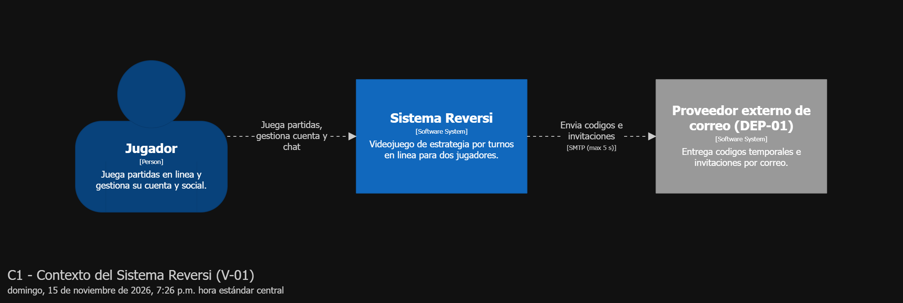

UNIVERSIDAD VERACRUZANA

FACULTAD DE ESTADÍSTICA E INFORMÁTICA

LICENCIATURA EN INGENIERÍA DE SOFTWARE

Diseño de Software

| Proyecto             | Reversi                         |
| -------------------- | ------------------------------- |
| Equipo e integrantes | César Daniel Ortega Castillejos Pedro Enrique Sánchez Rodríguez |
| Versión del documento | v0.3 |
| Entrega | Tercer corte |
| Fecha | 22/11/2026 |

# Documento de Arquitectura de Software (SAD)

---

## 1. Control y glosario

### 1.1 Control e historial

| Sistema | Reversi: Videojuego de estrategia por turnos con arquitectura cliente-servidor para partidas en línea de dos jugadores. |
| --- | --- |
| Propósito del documento | Permitir al lector evaluar la validez de los trade-offs técnicos seleccionados, implementar el cliente y el servidor de acuerdo con sus contratos e interfaces autoritativas, y planificar evoluciones del sistema. |
| Audiencia | Autoridad docente para evaluar la solidez y trazabilidad del diseño; equipo de desarrollo para guiar la construcción e integración de módulos; y testers (QA) para derivar las pruebas de verificación de los escenarios de calidad. |
| Alcance | Cubre el diseño integral del cliente de escritorio (WPF), el servidor autoritativo de partidas y sesiones (WCF) y la persistencia relacional (SQL Server). Quedan fuera del alcance el servicio de transporte de correo electrónico (dependencia externa), clientes web/móviles y el modo de juego local fuera de línea. |

| **Versión** | **Fecha**  | **Cambios principales**                                                                                                                                                                                                                      |
| ----------- | ---------- | -------------------------------------------------------------------------------------------------------------------------------------------------------------------------------------------------------------------------------------------- |
| v0.1        | 10/10/2026 | Primera entrega parcial: definición de frontera, interesados, drivers de calidad, árbol de utilidad, ASR prioritarios, decisiones ADR (001 a 006), catálogo de módulos C-01 a C-14, vistas V-01/V-02 y riesgos iniciales.                    |
| v0.2        | 15/11/2026 | Segundo avance. Se conciliaron los escenarios de calidad y los ASR. Se actualizaron los ADR y el catálogo de elementos a partir de las iteraciones ADD. Se documentaron las reglas de dependencia y se justificó la selección de vistas 4+1. |
| v0.3        | 22/11/2026 | Tercer corte. Se incorpora IT11 de preferencias de idioma, se documentan los contratos de los nueve drivers y la arquitectura en ejecución y se incorporan las fichas lógica y de procesos.                                                  |

### 1.2 Resumen de la arquitectura

El sistema Reversi es un juego distribuido por turnos para escritorio enfocado en garantizar la integridad absoluta de las partidas y una experiencia de usuario fluida con baja latencia.

La estructura responde a la integridad del juego (ASR-01), la recuperación ante desconexiones (ASR-02), la propagación de jugadas (ASR-03) y la retroalimentación en el tablero (ASR-06).

La solución usa un servidor autoritativo y separa los niveles lógicos de cliente, aplicación y datos.

- El cliente de escritorio (WPF) implementa un validador ligero de movimientos para guiar visualmente la interacción del usuario sin esperar viajes de red.
- El servidor WCF valida las jugadas y mantiene en memoria el estado de las partidas activas.
- La aplicación de servicio y el motor relacional se ejecutan como procesos independientes en el mismo dispositivo servidor.

### 1.3 Glosario

| Término | Significado en este proyecto |
| --- | --- |
| Flanqueo | Regla de Reversi donde una ficha colocada atrapa una o más fichas enemigas en línea recta (horizontal, vertical o diagonal) entre sí y otra ficha del jugador actual, provocando su volteo. |
| Jugada válida | Acción realizada por un jugador durante el contexto de una partida al seleccionar una posición válida |
| Posición válida | Celda o casilla del tablero en donde el sistema permite realizar una jugada por ofrecer posibilidades de flanqueo |
| Jugador | Participante de una partida con la capacidad para realizar jugadas válidas |
| Partida | Encuentro entre dos (2) jugadores compuesto de jugadas válidas |

### 1.4 Uso de IA generativa

| Qué pidieron                                                                                                                                                                                                                                                                            | Qué aceptaron y qué rechazaron                                                                                                                                                                                                                                                                                                                                                                 | Cómo lo verificaron                                                                                                                                                           |
| --------------------------------------------------------------------------------------------------------------------------------------------------------------------------------------------------------------------------------------------------------------------------------------- | ---------------------------------------------------------------------------------------------------------------------------------------------------------------------------------------------------------------------------------------------------------------------------------------------------------------------------------------------------------------------------------------------- | ----------------------------------------------------------------------------------------------------------------------------------------------------------------------------- |
| **Mejora de redacción apegada al dominio:** Redacción y pulido técnico de descripciones arquitectónicas, fichas de decisión (ADR), justificaciones de ASR y escenarios de calidad con terminología formal del dominio de Reversi y tácticas del SEI.                                    | **Aceptado:** La terminología formal, la redacción neutral de caja negra en las respuestas de escenarios (eliminando fugas prematuras de solución) y los trade-offs de diseño.  **Rechazado:** Propuestas que sugerían tecnologías o mecanismos fuera del alcance y stack estipulado (tales como colas RabbitMQ o persistencia síncrona en cada turno).                                  | Cotejo manual contra el glosario del proyecto (1.3), las restricciones técnicas formales (RES-TEC) y los términos de calidad del SEI / ISO 25010.                             |
| **Verificación de llenado correcto según reglas de la plantilla:** Auditoría de la estructura de las secciones de la primera entrega frente a las instrucciones de la plantilla SAD v5.0 y la lista de comprobación proporcionada.                                                      | **Aceptado:** El ajuste en la cantidad de elementos (10 escenarios y 7 ASR), la inclusión de las filas obligatorias de seguridad (activo, actor, límite) y el formato tabular de las fichas.  **Rechazado:** Formatos de redacción libre o listas desestructuradas que no respetaban las tablas canónicas de la plantilla.                                                               | Comparación punto por punto contra la lista de comprobación proporcionada de la plantilla y la rúbrica de evaluación docente.                                                 |
| **Verificación de identificadores permitidos en el documento:** Validación estricta del cumplimiento de la regla de los siete identificadores canónicos y trazabilidad entre secciones.                                                                                                 | **Aceptado:** La corrección y eliminación de sub-abreviaciones inventadas (reemplazando `QAS-SEG` por la nomenclatura canónica `QAS-Seguridad`), y la unificación de los catálogos de componentes (`C-01` a `C-14`) y riesgos (`R-01` a `R-03`).  **Rechazado:** Cualquier prefijo intermedio que violara la regla de identificadores de la plantilla.                                   | Rastreo y búsqueda en el texto para comprobar que solo existan los prefijos permitidos (QAS, ASR, ADR, C, V, EV, R) y que las referencias cruzadas entre secciones coincidan. |
| **Análisis y síntesis de avances de iteraciones:** Extracción y discriminación de la información técnica generada en las notas de las Iteraciones 1 a 5 de ADD para trasladar las decisiones esenciales a la entrega formal.                                                            | **Aceptado:** Sugerencias para la selección de decisiones arquitectónicas estructurales y la representación de la evolución histórica (marcando ADR-001 y ADR-002 como sustituidos por ADR-004 y ADR-005 tras la Iteración 5).  **Rechazado:** Trasladar decisiones de nivel de código, dependencias de bajo nivel o características descartadas (como el modo de juego fuera de línea). | Contraste contra las bitácoras de diseño de las Iteraciones 1 a 5 y los acuerdos de alcance establecidos con la autoridad organizacional.                                     |
| Consolidación del segundo avance con las iteraciones ADD y revisión contra el Word original.                                                                                                                                                                                            | Se conservaron las decisiones de diseño sustentadas por las iteraciones, el catálogo de módulos y las reglas de dependencia. Las estimaciones de red se registraron como análisis.                                                                                                                                                                                                             | Se contrastaron las secciones y las tablas con la plantilla. Se cotejaron los ADR, los elementos y las vistas con los documentos de diseño.                                   |

---

## 2. Drivers

### 2.1 Contexto y frontera

Reversi incluye el cliente de escritorio, los servicios remotos, la lógica de cuentas y partidas, el estado de las partidas activas y la persistencia relacional. El sistema gestiona jugadores, amistades, partidas, chat, estadísticas e historial. Los clientes se comunican con el servidor mediante contratos remotos y el servidor conserva la autoridad sobre el estado de las partidas. Fuera de la frontera queda el proveedor de correo, al que el sistema solicita los envíos. La vista V-01 muestra esta frontera y sus actores externos.

### 2.2 Interesados y preocupaciones

| Interesado                      | Qué le preocupa                                                                                                                                     |
| ------------------------------- | --------------------------------------------------------------------------------------------------------------------------------------------------- |
| STK-01 Jugador                  | Disponer de partidas justas y confiables, recibir respuesta adecuada durante el juego, conservar su progreso y recuperarse de desconexiones breves. |
| STK-02 Equipo de desarrollo     | Probar las reglas de forma aislada, localizar los cambios, controlar las dependencias y generar versiones distribuibles.                            |
| STK-05 Adversario               | Manipular el cliente, enviar jugadas ilegales o intentar modificar información sin autorización.                                                    |
| STK-06 Autoridad organizacional | Cumplir el alcance, las tecnologías obligatorias, el calendario y la documentación de las decisiones arquitectónicas.                               |
| STK-07 Responsable del producto | Mantener las funciones prioritarias y una experiencia de juego adecuada dentro del tiempo disponible.                                               |

### 2.3 Funciones clave

| Función (CU o HU) | ¿Arquitectónicamente significativa? | Por qué |
| --- | --- | --- |
| **CU-16 / HU-02: Realizar jugada** | **Sí** | **Estado compartido y concurrencia:** Requiere validar cada movimiento con el estado vigente de la partida, aplicar las reglas de flanqueo, conservar un único resultado válido y comunicar la actualización a ambos participantes en menos de 1 segundo. El servidor debe rechazar solicitudes ilegales o realizadas fuera de turno. |
| **HU-03: Controlar inactividad del turno** | **Sí** | **Comportamiento temporal:** Cada partida mantiene su propio tiempo de turno. Al agotarse el tiempo, el sistema debe seleccionar exactamente una posición válida, registrar la jugada automática y finalizar la partida cuando un jugador acumula tres agotamientos consecutivos. |
| **CU-11 / HU-01: Crear y coordinar sala de partida** | **Sí** | **Coordinación de estado distribuido:** Requiere crear una partida con un identificador único, registrar participantes remotos, mantener el estado de espera e iniciar el juego cuando se completa la sala. La opción para jugar contra el sistema está disponible desde que se muestra la pantalla de espera. |
| **CU-01 / RF-JUG-07: Registrar cuenta con verificación** | **Sí** | **Dependencia externa y consistencia:** Requiere comprobar la unicidad de los datos, generar y enviar un código temporal, validar el código y evitar la creación parcial de una cuenta cuando falla el correo o la persistencia. |
| **CU-26 / RF-SOC-01: Transmitir mensajes de chat en partida** | **Sí** | **Autorización y distribución concurrente:** Requiere comprobar que el jugador pertenece a la conversación, aplicar las reglas de moderación, almacenar el mensaje y comunicarlo a los participantes autorizados sin alterar el flujo de la partida. |
| **CU-09: Modificar idioma de la interfaz** | **Sí** | **Cambio de presentación:** Requiere cambiar los textos durante la ejecución, conservar la preferencia del jugador y evitar cambios en las reglas del juego o en los contratos de comunicación. |
| **CU-15: Unirse a partida mediante código** | **No** | Utiliza la estructura de creación, consulta y asignación de participantes definida para las partidas en espera. |
| **CU-05: Consultar perfil y estadísticas** | **No** | Es una operación de consulta que utiliza las responsabilidades generales de aplicación y persistencia. |
| **CU-21: Enviar solicitud de amistad** | **No** | Utiliza el flujo general de autorización, aplicación y persistencia sin introducir una estructura arquitectónica adicional. |
| **CU-28: Entrar como invitado** | **No** | Utiliza la estructura general de sesiones y la comunicación remota existente. |

### 2.4 Restricciones, supuestos y condiciones del negocio

| Tipo | Enunciado | Qué pasa si cambia o resulta falso |
| --- | --- | --- |
| **Restricción** | **RES-TEC-01:** La persistencia relacional debe implementarse utilizando Entity Framework. | Cambiar el mecanismo de acceso a datos obliga a sustituir las implementaciones de persistencia y revisar sus mapeos. |
| **Restricción** | **RES-TEC-02:** La comunicación remota entre el cliente y el servidor debe implementarse mediante Windows Communication Foundation (WCF). | Cambiar la tecnología de comunicación obliga a sustituir los contratos, los proxies y la configuración del canal remoto. |
| **Restricción** | **RES-TEC-03:** El cliente de escritorio debe desarrollarse con Windows Presentation Foundation (WPF) sobre el ecosistema .NET. | Exigir otra plataforma obliga a sustituir la presentación y revisar las capacidades disponibles para el cliente. |
| **Restricción** | **RES-TEC-04:** La persistencia relacional debe utilizar Microsoft SQL Server. | Cambiar el motor obliga a revisar el esquema, los tipos de datos, las consultas y la configuración de conexión. |
| **Condición de alcance** | El modo offline o local queda fuera del entregable principal para priorizar las partidas en línea. | Incorporarlo obliga a revisar la distribución de las reglas y las responsabilidades asignadas al cliente. |
| **Supuesto** | **ASM-02:** Se asume una carga base de 8 jugadores activos concurrentes, distribuidos en 4 partidas simultáneas de 2 jugadores. | Una carga mayor obliga a repetir las pruebas de capacidad y revisar la administración del estado, los recursos y la comunicación. |
| **Objetivo de negocio** | **OBJ-01:** Facilitar la adopción del juego reduciendo las barreras de acceso y aprendizaje. | Una experiencia difícil de comprender o iniciar puede reducir la incorporación de jugadores. |
| **Objetivo de negocio** | **OBJ-02:** Mantener una experiencia de juego confiable y consistente. | Los errores en el estado, las trampas o las interrupciones frecuentes pueden reducir la confianza de los jugadores. |
| **Condición organizacional** | **ORG-01 / ORG-02:** El proyecto es desarrollado por un equipo de dos personas dentro del periodo escolar asignado. | Un cambio en el tiempo o en la capacidad del equipo obliga a revisar el alcance y las prioridades. |
| **Condición organizacional** | **ORG-03:** El equipo realiza diseño, implementación, pruebas, documentación y despliegue sin equipos especializados independientes. | Las decisiones deben limitar la complejidad operativa y facilitar la comprobación del sistema por el mismo equipo. |

### 2.5 Escenarios de calidad y árbol de utilidad

#### Fichas de Escenarios de Calidad

| QAS-Seguridad-1 | Intento de realizar una jugada inválida |
| --- | --- |
| Fuente | STK-05 Adversario mediante un cliente modificado. |
| Estímulo | Solicita una jugada que viola las reglas, corresponde a otro turno o utiliza un estado desactualizado. |
| Entorno | Operación normal durante una partida en línea activa. |
| Artefacto | Estado de la partida y mecanismos responsables de procesar jugadas. |
| Respuesta | El sistema rechaza la solicitud y conserva el último estado válido de la partida. |
| Medida | El 100 % de las solicitudes identificadas como inválidas se rechazan sin colocar fichas, cambiar el turno, modificar el conteo ni persistir un movimiento. |
| Prioridad | (A, M) |
| Activo que se protege | Estado válido del tablero, turno, resultado e historial de la partida. |
| Actor de amenaza | Usuario con un cliente modificado o una solicitud de red adulterada. |
| Límite de confianza | Comunicación entre el cliente del jugador y el servidor que mantiene la autoridad de la partida. |

| QAS-Disponibilidad-1 | Recuperación ante desconexión temporal |
| --- | --- |
| Fuente | STK-01 Jugador que participa en una partida en línea. |
| Estímulo | Se interrumpe la comunicación del cliente durante una partida activa. |
| Entorno | Operación normal durante una partida en línea. |
| Artefacto | Sesión del jugador y estado de la partida. |
| Respuesta | El sistema conserva la partida durante el periodo permitido y reincorpora al jugador cuando restablece la conexión dentro de ese periodo. |
| Medida | Si la conexión se recupera en un máximo de 30 segundos, el jugador vuelve a la misma partida y recupera el último estado válido sin perder ni duplicar movimientos confirmados. |
| Prioridad | (A, A) |

| QAS-Disponibilidad-2 | Tolerancia a indisponibilidad de correo |
| --- | --- |
| Fuente | STK-01 Jugador que solicita una función que requiere el envío de correo. |
| Estímulo | El proveedor no responde o supera el tiempo permitido para completar el envío. |
| Entorno | Operación normal durante una función que requiere enviar un correo. |
| Artefacto | Comunicación con el proveedor externo de correo. |
| Respuesta | El sistema termina la operación de envío, informa el fallo al solicitante y permite que las operaciones no relacionadas con el correo continúen. |
| Medida | La operación de envío termina en un máximo de 5 segundos. Ninguna partida activa se cancela, se pausa o modifica su estado como consecuencia del fallo del proveedor. |
| Prioridad | (A, M) |

| QAS-Rendimiento-1 | Procesamiento y propagación de una jugada |
| --- | --- |
| Fuente | STK-01 Jugador en turno en una partida en línea. |
| Estímulo | Solicita realizar un movimiento válido durante su turno. |
| Entorno | Operación normal con hasta 8 jugadores activos concurrentes, distribuidos en 4 partidas simultáneas. |
| Artefacto | Procesamiento de jugadas y sincronización del estado de la partida. |
| Respuesta | El sistema valida la jugada, actualiza el estado y comunica el resultado a los dos participantes. |
| Medida | El tiempo desde el envío de la solicitud hasta que el estado actualizado queda disponible para ambos jugadores es menor a 1 segundo en el 95 % de las jugadas. |
| Prioridad | (A, M) |

| QAS-Rendimiento-2 | Gestión de inactividad durante un turno |
| --- | --- |
| Fuente | STK-01 Jugador cuyo turno se encuentra activo. |
| Estímulo | Se alcanza el límite configurado sin que el jugador realice una jugada y existen posiciones válidas. |
| Entorno | Partida en línea activa. El tiempo predeterminado del turno es de 40 segundos. |
| Artefacto | Control temporal, reglas y estado de la partida. |
| Respuesta | El sistema selecciona una posición válida, realiza una jugada automática y registra el agotamiento del turno. |
| Medida | Se realiza exactamente 1 jugada automática válida. Al tercer turno consecutivo agotado, la partida termina con derrota del jugador inactivo. |
| Prioridad | (M, M) |

| QAS-Usabilidad-1 | Identificación y prevención de jugadas inválidas |
| --- | --- |
| Fuente | STK-01 Jugador durante su turno. |
| Estímulo | Explora el tablero e intenta seleccionar una posición inválida. |
| Entorno | Operación normal durante una partida activa en el turno del jugador. |
| Artefacto | Interfaz del tablero e información del estado actual de la partida. |
| Respuesta | La interfaz identifica las posiciones válidas e impide que una posición inválida genere una solicitud de jugada. |
| Medida | El indicador de posiciones válidas aparece en un máximo de 1 segundo. El 100 % de las posiciones inválidas identificadas por la interfaz quedan bloqueadas y no modifican el tablero ni el turno. |
| Prioridad | (M, B) |

| QAS-Usabilidad-2 | Disponibilidad de la partida contra el sistema |
| --- | --- |
| Fuente | STK-01 Jugador que crea una partida. |
| Estímulo | Entra a la pantalla de espera de un contrincante. |
| Entorno | Operación normal después de crear una partida. |
| Artefacto | Flujo de creación y espera de la partida. |
| Respuesta | El sistema muestra la opción para iniciar una partida contra un oponente controlado por el sistema desde el inicio de la espera. |
| Medida | La opción está disponible desde la primera presentación de la pantalla de espera, con 0 segundos de espera obligatoria. |
| Prioridad | (M, B) |

| QAS-FacilidadPrueba-1 | Prueba aislada y determinista de las reglas |
| --- | --- |
| Fuente | STK-02 Equipo de desarrollo. |
| Estímulo | Ejecuta la suite automatizada de reglas utilizando estados conocidos del tablero. |
| Entorno | Entorno de desarrollo y pruebas automatizadas. |
| Artefacto | Reglas de movimientos, flanqueos, turnos, inactividad y finalización. |
| Respuesta | La suite establece estados concretos, ejecuta los eventos definidos y permite observar de forma determinista el resultado. |
| Medida | El 100 % de la suite de reglas se ejecuta en menos de 5 segundos sin iniciar WPF, WCF, SQL Server, Entity Framework ni el proveedor de correo. |
| Prioridad | (A, M) |

| QAS-Modificabilidad-1 | Incorporación de un nuevo idioma |
| --- | --- |
| Fuente | STK-02 Equipo de desarrollo. |
| Estímulo | Se solicita incorporar un nuevo idioma a la interfaz. |
| Entorno | Desarrollo o mantenimiento de la aplicación. |
| Artefacto | Presentación y recursos de localización. |
| Respuesta | El equipo agrega los recursos del idioma sin modificar las reglas ni los contratos remotos. |
| Medida | El 100 % de los cambios se concentra en archivos de recursos, requiere 0 cambios en las reglas o contratos remotos y se completa en menos de 4 horas. |
| Prioridad | (A, M) |

| QAS-Desplegabilidad-1 | Empaquetado de una nueva versión |
| --- | --- |
| Fuente | STK-02 Equipo de desarrollo. |
| Estímulo | Ejecuta el proceso definido para generar los instaladores de una versión. |
| Entorno | Finalización de una versión del cliente y del servidor. |
| Artefacto | Proceso de compilación y empaquetado. |
| Respuesta | El proceso compila y genera los instaladores correspondientes a la misma versión. |
| Medida | La generación se inicia con 1 comando y requiere 0 pasos manuales adicionales durante la compilación y el empaquetado. |
| Prioridad | (M, M) |

---

#### Árbol de utilidad

| Atributo de calidad | Refinamiento | Identificador y escenario | Prioridad (Importancia, Dificultad) |
| --- | --- | --- | --- |
| Disponibilidad | Recuperabilidad | QAS-Disponibilidad-1: Recuperación ante desconexión temporal | (A, A) |
| Disponibilidad | Tolerancia a fallos | QAS-Disponibilidad-2: Tolerancia a indisponibilidad de correo | (A, M) |
| Seguridad | Integridad | QAS-Seguridad-1: Intento de realizar una jugada inválida | (A, M) |
| Rendimiento | Latencia | QAS-Rendimiento-1: Procesamiento y propagación de una jugada | (A, M) |
| Rendimiento | Comportamiento temporal | QAS-Rendimiento-2: Gestión de inactividad durante un turno | (M, M) |
| Usabilidad | Prevención de errores | QAS-Usabilidad-1: Identificación y prevención de jugadas inválidas | (M, B) |
| Usabilidad | Acceso a función | QAS-Usabilidad-2: Disponibilidad de la partida contra el sistema | (M, B) |
| Facilidad de prueba | Aislamiento y control | QAS-FacilidadPrueba-1: Prueba aislada y determinista de las reglas | (A, M) |
| Modificabilidad | Internacionalización | QAS-Modificabilidad-1: Incorporación de un nuevo idioma | (A, M) |
| Facilidad de despliegue | Automatización | QAS-Desplegabilidad-1: Empaquetado de una nueva versión | (M, M) |

### 2.6 ASR prioritarios

| ASR        | Qué debe cumplir la arquitectura                                                                                                                                                                                                                                                                                               | Procedencia                       | Viene de                         |
| ---------- | ------------------------------------------------------------------------------------------------------------------------------------------------------------------------------------------------------------------------------------------------------------------------------------------------------------------------------ | --------------------------------- | -------------------------------- |
| **ASR-01** | La arquitectura debe mantener en el servidor la autoridad sobre el estado legal de cada partida. El servidor debe validar la regla, el turno y el estado vigente de cada movimiento. El 100 % de las solicitudes identificadas como inválidas debe rechazarse sin colocar fichas, cambiar el turno, modificar el conteo ni persistir un movimiento. | Función y escenario de calidad    | CU-16 / HU-02 y QAS-Seguridad-1  |
| **ASR-02** | La arquitectura debe conservar durante 30 segundos la sesión y el estado necesarios para reincorporar a un jugador desconectado. Si el jugador regresa dentro de ese periodo, debe recuperar la misma partida y el último estado válido sin pérdida ni duplicación de movimientos confirmados.                                 | Escenario de calidad              | QAS-Disponibilidad-1             |
| **ASR-03** | La arquitectura debe procesar una jugada válida y poner el estado actualizado a disposición de ambos participantes en menos de 1 segundo en el 95 % de los casos. Esta medida aplica con hasta 8 jugadores concurrentes distribuidos en 4 partidas simultáneas.                                                                | Escenario de calidad y supuesto   | QAS-Rendimiento-1 y ASM-02       |
| **ASR-04** | La arquitectura debe aislar la comunicación con el proveedor externo de correo. Cuando el proveedor no responda, la operación debe terminar en un máximo de 5 segundos e informar el fallo sin cancelar, pausar ni modificar partidas activas.                                                                                 | Escenario de calidad              | QAS-Disponibilidad-2             |
| **ASR-05** | La arquitectura debe organizar el sistema como una aplicación distribuida con un cliente de escritorio WPF y un servidor WCF. La comunicación debe realizarse mediante contratos remotos definidos y el cliente no debe acceder directamente a la lógica ni a la persistencia del servidor.                                    | Restricción                       | RES-TEC-02 y RES-TEC-03          |
| **ASR-06** | La arquitectura debe permitir que el cliente identifique las posiciones válidas en un máximo de 1 segundo y bloquee el 100 % de las posiciones que reconoce como inválidas antes de enviar una solicitud. Esta comprobación en el cliente no sustituye la validación definitiva del servidor.                                  | Función y escenario de calidad    | CU-16 / HU-02 y QAS-Usabilidad-1 |
| **ASR-07** | La arquitectura debe permitir ejecutar el 100 % de la suite automatizada de reglas en menos de 5 segundos. La suite debe controlar los estados de prueba y ejecutarse sin iniciar WPF, WCF, SQL Server, Entity Framework ni el proveedor externo de correo.                                                                    | Interesado y escenario de calidad | STK-02 y QAS-FacilidadPrueba-1   |

QAS-Desplegabilidad-1 se conserva como escenario planeado para la Iteración 4. No forma parte de los ASR prioritarios de esta entrega.

---

## 3. Decisiones

### 3.1 Índice de decisiones

| ADR | Decisión | Estado | ASR que atiende |
| --- | --- | --- | --- |
| **ADR-001** | Adopción de patrón de despliegue Two-Tier para cliente y servidor | Sustituido por ADR-004 | ASR-05 |
| **ADR-002** | Distribución de reglas mediante biblioteca compartida entre cliente y servidor | Sustituido por ADR-005 | ASR-01, ASR-06 |
| **ADR-003** | Selección de Windows Communication Foundation (WCF) como tecnología de comunicación remota | Aceptado | ASR-05 |
| **ADR-004** | Organización Three-Tier con dos dispositivos físicos | Aceptado | ASR-05 |
| **ADR-005** | Desacoplamiento de reglas mediante Servidor Autoritativo y Validador Ligero en Cliente | Aceptado | ASR-01, ASR-06 |
| **ADR-006** | Estado activo en memoria separado de la persistencia | Aceptado | ASR-02, ASR-03 |
| **ADR-007** | Contratos de salida y composición del servidor | Aceptado | ASR-07, ASR-04 |
| **ADR-008** | Organización funcional de la frontera de servicios | Aceptado | ASR-05, ASR-07 |
| **ADR-009** | Presentación del cliente con MVVM | Aceptado | ASR-06 |
| **ADR-010** | Proxy remoto en el Módulo de comunicación | Aceptado | ASR-05 |
| **ADR-011** | Control de versión al aplicar jugadas | Aceptado | ASR-01 |
| **ADR-012** | Opción de jugar contra el sistema desde la sala de espera | Aceptado | Sin ASR prioritario. Atiende QAS-Usabilidad-2. |
| **ADR-013** | Propagación del estado completo de la partida | Aceptado | ASR-03 |
| **ADR-014** | Tiempo límite para el proveedor de correo | Aceptado | ASR-04 |
| **ADR-015** | Almacenamiento de preferencias de idioma en el servidor | Aceptado | ASR-05 (CU-09) |
| **ADR-015** | Almacenamiento de preferencias de idioma en el servidor | Aceptado | ASR-05 y CU-09 |

### 3.2 Fichas de decisión

| ADR-001 | Adopción de patrón de despliegue Two-Tier para cliente y servidor |
| --- | --- |
| **Estado** | Sustituido por ADR-004 |
| **Contexto** | Se requería definir la distribución física inicial de la aplicación distribuida para dar soporte a la comunicación remota (ASR-05) con una configuración sencilla para dos desarrolladores. |
| **Alternativas** | **A (Two-Tier):** Nodo cliente ejecutando la aplicación de escritorio y nodo servidor alojando el host del servicio WCF junto con la base de datos SQL Server compartiendo el mismo entorno físico. *A favor:* Configuración inicial rápida y menor esfuerzo de administración de red. *En contra:* Acoplamiento físico del proceso de servicio con el motor de base de datos; contención de recursos de máquina.  **B (Three-Tier):** Separación física en tres niveles independientes (Cliente, Servidor de aplicaciones y Base de datos aislada). *A favor:* Aislamiento de fallos y preparación para despliegues independientes. *En contra:* Mayor sobrecarga de configuración de red y entornos para la etapa inicial. |
| **Criterios** | Simplicidad operativa inicial frente a desacoplamiento de infraestructura. |
| **Decisión** | Se adoptó inicialmente la Alternativa A (Two-Tier) para reducir la fricción inicial de configuración. |
| **Consecuencias** | Permitió iniciar el proyecto rápidamente, pero acopló el servicio al motor de base de datos. Fue sustituida en ADR-004 tras la revisión de alcance y evaluación de la arquitectura. |
| **Riesgos** | R-03 |
| **Elementos afectados** | C-04, C-12, C-14 |

| ADR-002 | Distribución de reglas mediante biblioteca compartida entre cliente y servidor |
| --- | --- |
| **Estado** | Sustituido por ADR-005 |
| **Contexto** | Se debía determinar cómo distribuir la lógica de Reversi para validar jugadas en el servidor (ASR-01) y proveer retroalimentación de casillas válidas en la interfaz del cliente (ASR-06). |
| **Alternativas** | **A (Biblioteca binaria compartida .dll):** Compilar el motor de reglas en una biblioteca común referenciada tanto por el proyecto de cliente como por el de servidor. *A favor:* Cero duplicación de código; un único punto de mantenimiento para el reglamento. *En contra:* Acoplamiento binario estrecho; cualquier cambio obliga a recompilar y desplegar sincronizadamente ambos extremos.  **B (Validación remota por red):** El cliente carece de reglas y consulta al servidor por red cada casilla sobre la que se mueve el cursor. *A favor:* Desacoplamiento total del cliente respecto al reglamento. *En contra:* Introduce latencia en la interfaz visual y satura la red con consultas innecesarias de casillas. |
| **Criterios** | Reutilización de código frente a independencia de despliegue y desacoplamiento binario. |
| **Decisión** | Se eligió inicialmente la Alternativa A (Biblioteca compartida). |
| **Consecuencias** | Centralizaba las reglas, pero ataba los ciclos de publicación del cliente y servidor. Fue sustituida en ADR-005 para favorecer la independencia de despliegue y la pre-validación de interfaz. |
| **Riesgos** | R-02 |
| **Elementos afectados** | C-01, C-02, C-05, C-06 |

| ADR-003 | Selección de Windows Communication Foundation (WCF) como tecnología de comunicación remota |
| --- | --- |
| **Estado** | Aceptado |
| **Contexto** | El sistema requiere un canal de comunicación remota cliente-servidor bajo .NET que satisfaga la restricción tecnológica obligatoria y permita invocar operaciones y sincronizar estados (ASR-05 / RES-TEC-02). |
| **Alternativas** | **A (Windows Communication Foundation - WCF):** Framework nativo de comunicación RPC en .NET con soporte de contratos fuertemente tipados (ServiceContract) y enlaces orientados a conexión (NetTcpBinding). *A favor:* Cumple directamente con RES-TEC-02; integración transparente con WPF en C#; manejo nativo de sesiones. *En contra:* Tecnología legacy con menor interoperabilidad fuera del ecosistema .NET Framework.  **B (gRPC sobre HTTP/2):** Framework moderno de alto rendimiento basado en buffers de protocolo. *A favor:* Serialización binaria eficiente y estándar contemporáneo en la industria. *En contra:* Requiere configuración externa adicional y se desvía del stack técnico formalmente estipulado. |
| **Criterios** | Cumplimiento de la restricción tecnológica impuesta (RES-TEC-02) y compatibilidad con el cliente WPF. |
| **Decisión** | Se elige la Alternativa A (WCF) empleando enlaces TCP para comunicación remota de baja sobrecarga. |
| **Consecuencias** | Se asegura plena compatibilidad con el entorno de desarrollo y contratos tipados. Se asume la dependencia tecnológica con el ecosistema de comunicación de .NET Framework. |
| **Riesgos** | R-03 |
| **Elementos afectados** | C-03, C-04 |

| ADR-004 | Organización Three-Tier con dos dispositivos físicos |
| --- | --- |
| **Estado** | Aceptado (Sustituye a ADR-001) |
| **Contexto** | Tras la revisión de alcance con la autoridad organizacional (IT5), se requería delimitar los niveles lógicos de cliente, aplicación y datos (`ASR-05`) manteniendo un despliegue operativo realista y manejable para un equipo de dos personas sin áreas externas de infraestructura (`ORG-01`, `ORG-03`). |
| **Alternativas** | **A (Tres niveles lógicos en dos dispositivos físicos):** El cliente WPF se ejecuta en el dispositivo del jugador, mientras que la aplicación de servicio WCF y la base de datos SQL Server se ejecutan como procesos independientes dentro del mismo dispositivo servidor. *A favor:* Conserva la separación lógica y de ciclos de ejecución entre aplicación y datos, sin añadir administración de red ni hardware adicional. *En contra:* Ambos procesos del servidor comparten recursos y dominio físico de fallos.  **B (Two-Tier monolítico en un proceso):** Mantener la aplicación y la persistencia dentro del mismo proceso. *A favor:* Menor esfuerzo de despliegue inicial. *En contra:* Mezcla responsabilidades y ciclos de ejecución.  **C (Tres dispositivos físicos independientes):** Alojar la base de datos en un tercer dispositivo separado. *A favor:* Aislamiento físico de recursos y fallos. *En contra:* Mayor sobrecarga operativa y no corresponde al despliegue real del proyecto. |
| **Criterios** | Separación de responsabilidades lógicas, fidelidad al despliegue real y costo de operación para el equipo. |
| **Decisión** | Se elige la Alternativa A: se mantienen los tres niveles lógicos (cliente, aplicación y datos) ejecutando la aplicación de servicio y la base de datos como procesos independientes en el mismo dispositivo servidor. |
| **Consecuencias** | Se preserva la modularidad lógica de los tres niveles con operación simple. Se acepta que una falla o saturación física del equipo servidor afecta a ambos procesos y limita el escalado físico independiente de los datos. |
| **Riesgos** | R-03 |
| **Elementos afectados** | C-03, C-04, C-12, C-14 |

| ADR-005 | Desacoplamiento de reglas mediante Servidor Autoritativo y Validador Ligero en Cliente |
| --- | --- |
| **Estado** | Aceptado (Sustituye a ADR-002) |
| **Contexto** | Es obligatorio proteger el juego contra clientes adulterados (ASR-01) y proveer retroalimentación visual inmediata al usuario sin enviar jugadas inválidas por la red (ASR-06), eliminando el acoplamiento binario de dependencias compartidas. |
| **Alternativas** | **A (Servidor Autoritativo con Validador Ligero en Cliente y duplicación deliberada):** El servidor concentra el Motor de Juego autoritativo completo (validación, flanqueo, turnos y fin de juego). El cliente integra un Validador Ligero independiente que solo evalúa casillas admisibles a partir de su tablero local para responder al cursor del usuario y filtrar selecciones ilegales antes de transmitirlas. *A favor:* Elimina el acoplamiento binario entre cliente y servidor; permite indicar las posiciones válidas con un objetivo de máximo 1 segundo (ASR-06); reduce el tráfico de red al descartar clics erróneos en el cliente; el servidor retiene la autoridad legal absoluta ante cualquier modificación no autorizada (ASR-01). *En contra:* Duplicación deliberada de la lógica básica de comprobación de casillas; requiere sincronización manual en ambos módulos si las reglas cambian.  **B (Mantener biblioteca binaria compartida DLL):** Distribuir la misma DLL compilada a ambos proyectos. *A favor:* Evita duplicación de código. *En contra:* Provoca acoplamiento de compilación y empaquetado; expone la lógica interna completa del servidor en el binario del cliente. |
| **Criterios** | Seguridad e integridad del juego (ASR-01), usabilidad y rendimiento de red (ASR-06) e independencia de artefactos. |
| **Decisión** | Se elige la Alternativa A, aceptando conscientemente la duplicación deliberada de la validación básica en pro del desacoplamiento y el rendimiento de red. |
| **Consecuencias** | Interfaz rápida sin latencia de red para el jugador y validación segura en el servidor. Se asume el compromiso de mantener alineadas ambas implementaciones ante evoluciones del reglamento. |
| **Riesgos** | R-02 |
| **Elementos afectados** | C-01, C-02, C-05, C-06 |

| ADR-006 | Estado activo en memoria separado de la persistencia |
| --- | --- |
| **Estado** | Aceptado |
| **Contexto** | Para cumplir la recuperación ante desconexiones breves durante 30 segundos (`ASR-02`) y responder jugadas en menos de 1 segundo bajo concurrencia (`ASR-03`), el flujo activo de una partida y su reconexión temporal no deben quedar bloqueados por la latencia o indisponibilidad momentánea de la base de datos (IT3). |
| **Alternativas** | **A (Estado activo en memoria separado de la representación persistente):** El estado vigente de las partidas y la asociación temporal de 30 segundos se mantienen en memoria, mientras el almacenamiento relacional conserva cuentas, historial y datos durables de forma separada. *A favor:* Permite respuestas rápidas en el flujo de juego y reconexión sin depender de consultas a disco; aísla fallos transitorios de SQL Server frente a partidas activas. *En contra:* Exige controlar el periodo de conservación temporal y aceptar pérdida de estado volátil si cae el proceso del servidor.  **B (Usar la base de datos relacional como estado de trabajo por jugada):** Consultar y actualizar SQL Server de forma síncrona en cada operación y reconexión. *A favor:* Durabilidad inmediata en disco ante caídas del proceso. *En contra:* Condiciona la continuidad y tiempos de respuesta de la partida a la latencia y disponibilidad de SQL Server.  **C (Introducir una base de datos en memoria externa):** Incorporar un motor de caché distribuida adicional. *A favor:* Persistencia temporal desacoplada del proceso de aplicación. *En contra:* Agrega otra tecnología y carga operativa injustificada para 8 jugadores concurrentes (`ASM-02`). |
| **Criterios** | Recuperación dentro de 30 segundos (`ASR-02`), latencia de jugada (`ASR-03`) y simplicidad operativa. |
| **Decisión** | Se elige la Alternativa A: el Módulo de estado de juego (`C-07`) mantiene en memoria el estado activo de la partida y la ventana de 30 segundos para reconexión, separado del Módulo de persistencia (`C-12`). |
| **Consecuencias** | La partida continúa y se recupera con rapidez mientras el proceso del servidor permanezca en ejecución. Se asume la pérdida del estado volátil no persistido ante una caída abrupta del proceso y la responsabilidad de liberar sesiones expiradas tras 30 segundos. |
| **Riesgos** | R-01 |
| **Elementos afectados** | C-05, C-07, C-12 |

| ADR-007 | Contratos de salida y composición del servidor |
| --- | --- |
| **Estado** | Aceptado |
| **Contexto** | El equipo requiere ejecutar el 100 % de la suite automatizada de reglas en menos de 5 segundos sin levantar WPF, WCF, SQL Server, Entity Framework ni el proveedor externo de correo (`ASR-07`), aislando además fallos de correo (`ASR-04`) y permitiendo trabajo paralelo entre capas (`STK-02`, `ORG-01`, `TEN-04`) en IT6. |
| **Alternativas** | **A (Inversión de dependencias selectiva en salidas, raíz de composición y separación de modelos en fronteras):** La capa de negocio opera con modelos propios y define contratos abstractos de salida para persistencia y correo; la raíz de composición ensambla e inyecta las implementaciones concretas en el arranque. *A favor:* Permite sustituir persistencia y correo por dobles de prueba en memoria en menos de 5 segundos; protege el dominio frente a restricciones del ORM o WCF; evita ceremonias excesivas para dos desarrolladores. *En contra:* La capa de servicio depende de la firma de los módulos de negocio y requiere mantener modelos separados y traducciones explícitas en los bordes.  **B (Arquitectura Hexagonal completa con puertos simétricos en todas las fronteras):** Desacoplar entradas y salidas mediante puertos y adaptadores independientes por cada caso de uso. *A favor:* Aislamiento máximo y simétrico en todas las fronteras. *En contra:* Multiplica interfaces, objetos intermedios y esfuerzo de mantenimiento para un equipo de dos personas (`TEN-04`, `ORG-01`).  **C (Capas tradicionales con dependencia directa hacia persistencia y correo):** Permitir que negocio invoque directamente implementaciones de datos y correo e instancie dependencias internamente. *A favor:* Menor número de contratos iniciales. *En contra:* Obliga a cargar ORM, SQL Server y correo para probar la lógica de negocio, incumpliendo `ASR-07`. |
| **Criterios** | Facilidad de prueba aislada (`ASR-07`), trabajo paralelo (`STK-02`) y simplicidad estructural (`TEN-04`). |
| **Decisión** | Se elige la Alternativa A: negocio define los contratos de salida por área funcional, persistencia (`C-12`) y el despachador de correo (`C-11`) los implementan, las traducciones de modelos ocurren en las fronteras y la raíz de composición (`C-15`) conecta todo en el arranque. |
| **Consecuencias** | Las pruebas unitarias reemplazan dependencias externas con facilidad sin contaminar el dominio. El equipo asume el mantenimiento de los contratos de salida, la traducción de modelos en fronteras y el ensamblado centralizado en `C-15`. |
| **Riesgos** | Ninguno identificado |
| **Elementos afectados** | C-04, C-05, C-08, C-09, C-10, C-11, C-12, C-15 |

| ADR-008 | Organización funcional de la frontera de servicios |
| --- | --- |
| **Estado** | Aceptado |
| **Contexto** | Un único punto de entrada monolítico para todas las operaciones remotas del servidor (`C-04`) acumularía dependencias hacia todo el negocio, mezclaría canales simples con canales de tiempo real y provocaría colisiones al trabajar en paralelo (`STK-02`, `ORG-01`), dificultando pruebas focalizadas (`ASR-07`) y cambios localizados (`ASR-05`) en IT6. |
| **Alternativas** | **A (Descomposición por cohesión funcional en submódulos de servicio):** Dividir el Módulo de servicios en ocho submódulos especializados por área (cuentas, sesiones, perfil, clasificación, amistades, sala de espera, partida en curso y chat). *A favor:* Reduce el acoplamiento de cada servicio a su área de negocio, facilita cambios localizados en paralelo y permite probar cada frontera sin inicializar las demás. *En contra:* Incrementa la cantidad de puntos de entrada remotos que deben configurarse y coordinarse.  **B (Fachada única monolítica de servicios):** Exponer todas las operaciones del sistema en un único módulo de servicio. *A favor:* Un solo punto de acceso para configurar. *En contra:* Concentra dependencias hacia todos los módulos de negocio, genera conflictos de edición paralela y obliga a inicializar todo el servidor para probar una operación. |
| **Criterios** | Cohesión funcional, disminución de acoplamiento, trabajo paralelo (`ORG-01`) y facilidad de prueba (`ASR-07`). |
| **Decisión** | Se elige la Alternativa A: subdividir `C-04` en los submódulos funcionales `C-30` a `C-37`, donde cada uno delega únicamente al módulo de negocio de su área y utiliza `C-13` para el registro de eventos. |
| **Consecuencias** | Los cambios y pruebas quedan acotados por área funcional y se evitan colisiones entre desarrolladores. Se acepta gestionar y configurar ocho contratos de servicio en el arranque y en el cliente. |
| **Riesgos** | Ninguno identificado |
| **Elementos afectados** | C-04, C-13, C-15, C-30 a C-37 |

| ADR-009 | Presentación del cliente con MVVM |
| --- | --- |
| **Estado** | Aceptado |
| **Contexto** | El cliente de escritorio en WPF (`RES-TEC-03`) necesita separar el comportamiento e interacción de los controles visuales para facilitar modificaciones y probar la lógica de presentación sin levantar ventanas gráficas (`STK-02`, `TEN-04`), manteniendo la ruta de prevalidación local del tablero (`ASR-06`) en IT7 e IT9. |
| **Alternativas** | **A (Patrón MVVM con enlaces de datos):** Las vistas WPF muestran el estado expuesto por su ViewModel y le entregan las acciones del usuario; el ViewModel coordina validaciones locales y llamadas remotas. *A favor:* Aprovecha el enlace de datos nativo de WPF y permite probar la lógica de presentación sin instanciar controles visuales. *En contra:* Exige mantener enlaces en XAML y sincronizar el estado observable.  **B (Lógica de interacción en el código detrás de cada vista):** Manejar eventos, llamadas remotas y reglas locales directamente en la vista. *A favor:* Sencillo para pantallas pequeñas sin estado complejo. *En contra:* Mezcla la coordinación operativa con eventos de controles gráficos, impidiendo probarla sin cargar WPF.  **C (Patrón MVP con interfaces de vista):** Coordinar la pantalla mediante presentadores que actualizan la vista a través de interfaces explícitas. *A favor:* Desacopla la vista del presentador. *En contra:* Obliga a definir y mantener interfaces de vista adicionales cuando WPF ya resuelve la sincronización mediante enlaces de datos. |
| **Criterios** | Facilidad de prueba de presentación (`STK-02`), aprovechamiento de WPF y simplicidad estructural (`TEN-04`). |
| **Decisión** | Se elige la Alternativa A (MVVM): `C-01` se organiza por flujo de usuario (`C-16` a `C-23`), donde cada vista se enlaza a su ViewModel y este consume la validación local (`C-02`) y los clientes remotos (`C-03`). |
| **Consecuencias** | Se prueba el comportamiento de interacción sin depender del entorno gráfico de WPF y se mantiene limpia la separación entre controles y estado. Requiere disciplina para mantener la sincronización y enlaces de presentación. |
| **Riesgos** | R-02 |
| **Elementos afectados** | C-01, C-02, C-03, C-16 a C-23 |

| ADR-010 | Proxy remoto en el Módulo de comunicación |
| --- | --- |
| **Estado** | Aceptado |
| **Contexto** | La capa de presentación del cliente (`C-01`) debe comunicarse con los ocho servicios remotos del servidor (`ASR-05`) sin quedar expuesta a los tipos de red, canales dúplex ni errores de transporte de WCF, conservando la sustituibilidad para pruebas (`STK-02`, `TEN-04`) en IT7. |
| **Alternativas** | **A (Proxy remoto por área en el Módulo de comunicación, agrupando partidas):** Encapsular el acceso a los servicios en clientes remotos (`C-24` a `C-29`), reuniendo en `Cliente de partidas` (`C-29`) los contratos de sala, partida en curso y chat por compartir el mismo flujo y ciclo de vida de juego. *A favor:* Aísla a presentación del ciclo de vida de canales WCF, centraliza la gestión de errores de red y permite sustituir clientes en pruebas. *En contra:* `Cliente de partidas` acumula operaciones y dependencias de tres contratos remotos.  **B (Gestionar comunicación directamente desde cada ViewModel):** Cada ViewModel abre conexiones, maneja callbacks y captura fallos de red. *A favor:* Evita clientes intermedios por servicio. *En contra:* Dispersa la gestión de canales y errores entre pantallas y dificulta sustituir la red en pruebas.  **C (Consumir directamente proxies WCF generados desde presentación):** Usar los clientes autogenerados de WCF en los ViewModels. *A favor:* Reutiliza clases generadas sin envoltura adicional. *En contra:* Expone a presentación a tipos y ciclo de vida propios de WCF. |
| **Criterios** | Aislamiento del transporte remoto (`ASR-05`), sustituibilidad en pruebas (`STK-02`) y simplicidad de coordinación (`TEN-04`). |
| **Decisión** | Se elige la Alternativa A: el Módulo de comunicación (`C-03`) implementa Proxy remoto mediante `C-24` a `C-29`, traduciendo respuestas y fallos hacia presentación y agrupando sala, partida en curso y chat en `C-29`. |
| **Consecuencias** | Presentación queda desacoplada de WCF y de sus cargas útiles. Se acepta que `C-29` concentre dependencias de tres contratos; si esas áreas comienzan a cambiar de forma independiente, `C-29` podrá dividirse en tres clientes dentro de `C-03`. |
| **Riesgos** | Ninguno identificado |
| **Elementos afectados** | C-01, C-03, C-04, C-24 a C-29 |

| ADR-011 | Control de versión al aplicar jugadas |
| --- | --- |
| **Estado** | Aceptado |
| **Contexto** | Un cliente modificado (`STK-05`) o con estado atrasado puede enviar una jugada preparada sobre un tablero anterior que siga pareciendo legal en el tablero vigente (`QAS-Seguridad-1`, `ASR-01`), generando cambios no deseados si el estado cambia entre la comprobación y la aplicación (IT8). |
| **Alternativas** | **A (Exigir versión esperada y compararla bajo acceso exclusivo por partida):** La solicitud incluye la versión del tablero sobre la cual se eligió la jugada; `C-05` compara esa versión contra la vigente y, solo si coincide, delega al motor (`C-06`) y avanza la versión dentro del mismo acceso exclusivo de esa partida. *A favor:* Rechaza el 100 % de solicitudes obsoletas antes de invocar al motor y elimina condiciones de carrera al validar y aplicar el movimiento. *En contra:* Exige que el cliente conserve y envíe la versión, y serializa las escrituras sobre una misma partida.  **B (Validar únicamente la posición contra el estado vigente):** Verificar solo si la casilla es legal en el tablero actual sin comprobar versión previa. *A favor:* Mensajes más simples sin control de versión en el cliente. *En contra:* Permite aplicar una jugada calculada sobre un estado anterior si la casilla sigue siendo válida en el nuevo tablero. |
| **Criterios** | Integridad absoluta del estado legal (`ASR-01`) y prevención de condiciones de carrera por partida. |
| **Decisión** | Se elige la Alternativa A: `C-05` exige la versión esperada en cada solicitud de jugada, la compara con la versión vigente en `C-07` bajo acceso exclusivo por partida y rechaza solicitudes desactualizadas antes de modificar tablero, turno o persistencia. |
| **Consecuencias** | Garantiza coherencia entre lo que vio el jugador y el estado que autoriza el servidor. El cliente debe consultar nuevamente el estado vigente tras un rechazo por versión anterior, y las operaciones sobre una misma partida esperan brevemente mientras se resuelve la jugada en curso. |
| **Riesgos** | Ninguno identificado |
| **Elementos afectados** | C-03, C-04, C-05, C-06, C-07 |

| ADR-012 | Opción de jugar contra el sistema desde la sala de espera |
| --- | --- |
| **Estado** | Aceptado |
| **Contexto** | Un jugador que crea una sala debe poder optar por jugar contra un oponente automatizado del sistema sin demoras obligatorias (`QAS-Usabilidad-2`, `OBJ-01`), evitando abandono cuando no desea esperar otro jugador humano (IT9). |
| **Alternativas** | **A (Habilitar la opción desde la primera presentación de la sala con 0 segundos de espera):** `Sala de partida` (`C-20`) muestra habilitada la opción desde que aparece al anfitrión, distinguiéndola de la espera de otro jugador y abriendo la partida en curso al recibir confirmación del servidor. *A favor:* Cumple con los 0 segundos de espera obligatoria y reduce la fricción de entrada. *En contra:* Exige coordinar en sala la transición inmediata entre espera humana y partida contra el sistema.  **B (Habilitar la opción tras agotar un tiempo de espera):** Mostrar la alternativa solo después de transcurrir varios minutos sin encontrar rival humano. *A favor:* Prioriza el emparejamiento entre jugadores humanos. *En contra:* Introduce una espera obligatoria que incumple directamente `QAS-Usabilidad-2`. |
| **Criterios** | Disponibilidad inmediata en la primera presentación de la sala (`QAS-Usabilidad-2`) y claridad de flujo para el anfitrión. |
| **Decisión** | Se elige la Alternativa A: el ViewModel de `C-20` habilita jugar contra el sistema desde la primera vista de la sala de espera (0 segundos de espera obligatoria) y solicita el inicio mediante `C-29` hacia `C-05`. |
| **Consecuencias** | Elimina tiempos muertos forzados para quien prefiere jugar de inmediato contra el sistema. La sala debe distinguir claramente el estado de espera humana frente a la confirmación de partida contra el sistema y reflejar posibles errores de inicio. |
| **Riesgos** | Ninguno identificado |
| **Elementos afectados** | C-01, C-03, C-04, C-05, C-20, C-29 |

| ADR-013 | Propagación del estado completo de la partida |
| --- | --- |
| **Estado** | Aceptado |
| **Contexto** | Cada jugada válida o vencimiento de turno debe quedar disponible para ambos jugadores en menos de 1 segundo en el 95 % de los casos con hasta 8 jugadores en 4 partidas (`ASR-03`, `QAS-Rendimiento-2`), definiendo el formato de mensajes entre `C-36` y `C-29` en IT10. |
| **Alternativas** | **A (Enviar el estado completo de 64 celdas por respuesta y notificación dúplex):** El servidor devuelve al solicitante y notifica a los suscriptores la instantánea completa con su versión; el cliente descarta copias repetidas u obsoletas por versión. *A favor:* Permite al cliente actualizar y recuperarse en un solo mensaje incluso si perdió estados previos; en el análisis de carga (49,2 ms favorable y 393,2 ms extremo en 4 partidas a 1 Mbit/s) mantiene margen dentro de 1 segundo. *En contra:* Retransmite las 64 celdas en cada jugada y el solicitante puede recibir duplicado por respuesta y notificación.  **B (Enviar solo cambios por jugada con versión base):** Transmitir la casilla colocada, fichas volteadas y versión base. *A favor:* Ahorra cerca de 4,4 ms por ráfaga en el caso favorable y reduce bytes cuando hay pocos volteos. *En contra:* En el peor caso ocupa lo mismo que el estado completo y exige una consulta adicional de estado completo si al cliente le falta la versión base. |
| **Criterios** | Cumplimiento de latencia (`ASR-03`), tolerancia ante pérdida o desorden de estados y simplicidad en el cliente. |
| **Decisión** | Se elige la Alternativa A: `C-36` propaga el estado completo en la respuesta y notificaciones dúplex tras cada jugada o vencimiento de turno, y `C-29` filtra copias repetidas mediante la versión de `ADR-011`. |
| **Consecuencias** | Simplifica la sincronización y recuperación del cliente ante mensajes perdidos. Se acepta el costo de retransmitir el tablero completo y de descartar copias repetidas en el cliente; la meta del percentil 95 queda sujeta a verificación empírica bajo carga (`R-03`). |
| **Riesgos** | R-03 |
| **Elementos afectados** | C-01, C-03, C-04, C-05, C-07, C-29, C-36 |

| ADR-014 | Tiempo límite para el proveedor de correo |
| --- | --- |
| **Estado** | Aceptado |
| **Contexto** | El registro y otras funciones de cuenta dependen de un proveedor externo de correo electrónico (`DEP-01`); su lentitud o caída no debe retener hilos ni degradar las partidas en curso, debiendo concluir en un máximo de 5 segundos (`QAS-Disponibilidad-2`, `ASR-04`) según IT3. |
| **Alternativas** | **A (Fallo rápido con tiempo límite acotado de 5 segundos):** El `Módulo despachador de correo` (`C-11`) ejecuta el despacho con un límite estricto de 5 segundos; si el proveedor no responde, cancela la espera e informa el fallo al solicitante. *A favor:* Protege los hilos del servidor y garantiza respuesta acotada sin infraestructura adicional. *En contra:* Si el proveedor externo falla temporalmente, el usuario debe reintentar manualmente su solicitud.  **B (Esperar sin límite o reintentar en la misma solicitud):** Mantener la petición abierta o reintentar internamente ante fallos del proveedor. *A favor:* Podría absorber microcortes sin intervención del usuario. *En contra:* Retiene hilos del servidor durante caídas prolongadas e incumple el máximo de 5 segundos (`ASR-04`).  **C (Cola persistente asíncrona de reintentos):** Encolar mensajes en segundo plano y reintentarlos periódicamente. *A favor:* Eventual entrega sin repetir la solicitud. *En contra:* Introduce infraestructura de colas y gestión de reintentos innecesaria para códigos temporales de verificación. |
| **Criterios** | Cumplimiento del límite máximo de 5 segundos (`ASR-04`), aislamiento de fallos (`QAS-Disponibilidad-2`) y simplicidad operativa (`ORG-01`). |
| **Decisión** | Se elige la Alternativa A: `C-11` aplica fallo rápido (*Fail-Fast*) con tiempo límite estricto de 5 segundos al comunicarse con `DEP-01` e informa el error de vuelta al solicitante sin afectar partidas activas. |
| **Consecuencias** | Las caídas o latencias del proveedor externo quedan aisladas a la operación solicitada y no bloquean hilos de juego. El usuario debe solicitar un nuevo envío cuando el proveedor se restablezca. |
| **Riesgos** | Ninguno residual registrado (dependencia externa acotada a 5 s) |
| **Elementos afectados** | C-08, C-11, DEP-01 |

| ADR-015 | Almacenamiento de preferencias de idioma en el servidor |
| --- | --- |
| **Estado** | Aceptado |
| **Contexto** | Para soportar `CU-09` (Modificar idioma de interfaz) conservando la preferencia de cada cuenta entre sesiones y dispositivos sin mezclarla con los datos públicos del jugador ni acoplar los recursos visuales con la comunicación y almacenamiento (`STK-02`, `ASR-05`) en IT11. |
| **Alternativas** | **A (Preferencia de cuenta almacenada en el servidor con módulo dedicado):** Incorporar un flujo remoto propio (`C-42` a `C-45`) que guarda el idioma de la cuenta en el servidor antes de aplicarlo en pantalla, mientras los invitados aplican el idioma solo durante su sesión. *A favor:* Conserva el idioma de la cuenta entre sesiones y separa la configuración de uso respecto al perfil público. *En contra:* Guardar la preferencia de cuenta depende de disponibilidad remota y un fallo posterior de carga local de recursos puede dejar temporalmente distinto el idioma guardado del mostrado.  **B (Almacenar la preferencia únicamente en el equipo cliente):** Guardar el idioma en archivos locales sin contrato remoto. *A favor:* Cambia de idioma sin consultar al servidor. *En contra:* La preferencia queda ligada a un solo equipo y no sigue a la cuenta.  **C (Incluir la preferencia dentro del flujo de modificación de perfil):** Reutilizar el servicio de perfil existente para guardar el idioma. *A favor:* Evita agregar nuevas fronteras para preferencias. *En contra:* Mezcla la configuración de interfaz del usuario con los datos públicos de su perfil. |
| **Criterios** | Persistencia asociada a la cuenta, separación de responsabilidades (`STK-02`) y uso de contratos remotos (`ASR-05`). |
| **Decisión** | Se elige la Alternativa A: se incorporan `C-42` a `C-45` para consultar y guardar el idioma de la cuenta en el servidor antes de aplicarlo visualmente en `C-18`. |
| **Consecuencias** | La preferencia de idioma persiste asociada a la cuenta con fronteras limpias en cliente, servicio, negocio y datos. Se acepta la dependencia remota al guardar y el desacople temporal si falla la carga local de recursos tras confirmar el guardado. |
| **Riesgos** | Ninguno identificado |
| **Elementos afectados** | C-01, C-18, C-42, C-43, C-44, C-45 |

---

## 4. Estructura

### 4.1 Módulos y componentes

| ID | Nombre y tipo | Responsabilidad | Provee / requiere |
| --- | --- | --- | --- |
| C-01 | Módulo de presentación (Cliente · Presentación) | Presenta la interfaz y organiza vistas y ViewModels por flujo. | C-02 y C-03 según el flujo. |
| C-02 | Módulo validador de interfaz (Cliente · Negocio) | Evalúa posiciones válidas y políticas de entrada locales. | Provee comprobaciones locales a C-01. |
| C-03 | Módulo de comunicación (Cliente · Datos) | Encapsula las llamadas remotas, las notificaciones y la traducción de datos. | Contratos remotos provistos por C-04. |
| C-04 | Módulo de servicios (Servidor · Servicios) | Expone los contratos remotos y delega al área de negocio correspondiente. | Módulos de negocio y C-13. |
| C-05 | Módulo de juego (Servidor · Negocio) | Coordina salas, partidas, turnos y movimientos. Comprueba la versión esperada. | C-06, C-07 y contratos de persistencia de partidas y envío de correo. |
| C-06 | Módulo motor de juego (Servidor · Negocio) | Valida jugadas, resuelve el flanqueo y evalúa las condiciones de victoria. | Provee reglas autoritativas a C-05. |
| C-07 | Módulo de estado de juego (Servidor · Negocio) | Conserva el tablero, el turno, la versión y los participantes de las partidas activas. | Provee el estado activo a C-05. |
| C-08 | Módulo de jugadores (Servidor · Negocio) | Gestiona cuentas, autenticación, perfiles y sesiones. | Contratos de persistencia de jugadores y envío de correo. |
| C-09 | Módulo de amistades (Servidor · Negocio) | Gestiona contactos y solicitudes de amistad. | C-08 y contrato de persistencia de amistades. |
| C-10 | Módulo de chat (Servidor · Negocio) | Gestiona mensajes entre participantes de la partida. | C-05 y contrato de persistencia de chat. |
| C-11 | Módulo despachador de correo (Servidor · Servicios) | Despacha correo con un máximo de 5 segundos. | Provee el contrato de envío de correo. Requiere DEP-01. |
| C-12 | Módulo de persistencia (Servidor · Persistencia) | Agrupa los módulos que guardan y consultan datos por área. | Provee los contratos de persistencia. Requiere C-14. |
| C-13 | Módulo de registro de eventos (Servidor · Transversal) | Registra eventos y fallos del servidor. | Provee registro a C-04. Requiere almacenamiento local. |
| C-14 | Base de datos relacional (Servidor · Almacén en ejecución) | Almacena los datos relacionales en un proceso independiente del servicio. | Provee almacenamiento a C-12. |
| C-15 | Raíz de composición del servidor (Servidor · Arranque) | Ensambla el servidor y conecta contratos con implementaciones. | C-04, módulos de negocio y C-11 a C-13. |
| C-16 | Acceso y registro (submódulo de C-01) | Presenta el inicio de sesión, el acceso como invitado y la creación de cuentas. | Cliente de sesiones, Cliente de cuentas, políticas de entrada y apoyo de presentación. |
| C-17 | Menú principal (submódulo de C-01) | Muestra la clasificación y la lista de amigos. Permite acceder a partidas y cerrar sesión. | Cliente de clasificación, Cliente de amistades, Cliente de sesiones y apoyo de presentación. |
| C-18 | Perfil y configuración (submódulo de C-01) | Presenta el perfil y las opciones de interfaz. Desde el perfil también se pueden enviar solicitudes de amistad. | Cliente de perfil, Cliente de cuentas, Cliente de preferencias y apoyo de presentación. |
| C-19 | Amistades (submódulo de C-01) | Presenta la búsqueda de jugadores y las solicitudes de amistad. | Cliente de amistades y apoyo de presentación. |
| C-20 | Sala de partida (submódulo de C-01) | Presenta la creación, la búsqueda y la espera de partidas. | Cliente de partidas, comprobaciones de juego y apoyo de presentación. |
| C-21 | Partida en curso (submódulo de C-01) | Muestra el tablero, recibe las acciones de juego y presenta el chat de la partida. | Cliente de partidas, comprobaciones de juego y apoyo de presentación. |
| C-22 | Historial de partidas (submódulo de C-01) | Presenta el historial y permite abrir la información de una partida. | Cliente de partidas |
| C-23 | Apoyo de presentación (submódulo de C-01) | Proporciona diálogos, localización, estado local de sesión y acceso a los clientes remotos compartidos. | Cliente de sesiones, Cliente de cuentas, Cliente de perfil, Cliente de clasificación, Cliente de amistades y Cliente de partidas. |
| C-24 | Cliente de sesiones (submódulo de C-03) | Solicita el inicio y cierre de sesión y el acceso como invitado. | Contrato remoto de sesiones. |
| C-25 | Cliente de cuentas (submódulo de C-03) | Envía operaciones de registro y administración de la cuenta. | Contrato remoto de cuentas. |
| C-26 | Cliente de perfil (submódulo de C-03) | Consulta y actualiza el perfil y su imagen. | Contrato remoto de perfil. |
| C-27 | Cliente de clasificación (submódulo de C-03) | Consulta la clasificación de jugadores. | Contrato remoto de clasificación. |
| C-28 | Cliente de amistades (submódulo de C-03) | Envía operaciones de amistad y recibe sus notificaciones. | Contrato remoto de amistades. |
| C-29 | Cliente de partidas (submódulo de C-03) | Agrupa las llamadas remotas de sala, partida en curso y chat. | Contrato remoto de sala de partida, Contrato remoto de partida en curso y Contrato remoto de chat de partida. |
| C-30 | Servicio de registro de cuentas (submódulo de C-04) | Expone el registro de cuentas y traduce datos hacia el negocio. | Módulo de jugadores, Módulo de registro de eventos |
| C-31 | Servicio de sesiones (submódulo de C-04) | Expone autenticación, sesiones de invitado y cierre de sesión. | Módulo de jugadores, Módulo de registro de eventos |
| C-32 | Servicio de perfil de jugador (submódulo de C-04) | Expone consulta y actualización de perfil e imagen. | Módulo de jugadores, Módulo de registro de eventos |
| C-33 | Servicio de clasificación (submódulo de C-04) | Expone la consulta de la tabla global de posiciones. | Módulo de jugadores, Módulo de registro de eventos |
| C-34 | Servicio de amistades (submódulo de C-04) | Expone la gestión de amistades y notificaciones de presencia en línea. | Módulo de amistades, Módulo de registro de eventos |
| C-35 | Servicio de sala de partida (submódulo de C-04) | Expone creación, listado, invitación, unión y configuración previa de salas. | Módulo de juego, Módulo de registro de eventos |
| C-36 | Servicio de partida en curso (submódulo de C-04) | Expone jugadas, estado en curso, observación, abandono e historial de partidas. | Módulo de juego, Módulo de registro de eventos |
| C-37 | Servicio de chat de partida (submódulo de C-04) | Expone mensajería en tiempo real e historial de chat de partida. | Módulo de chat, Módulo de registro de eventos |
| C-38 | Módulo de datos de partidas (submódulo de C-12) | Implementa el contrato de persistencia de partidas y traduce hacia la base de datos relacional. | Contrato de persistencia de partidas (implementa), Base de datos relacional |
| C-39 | Módulo de datos de chat (submódulo de C-12) | Implementa el contrato de persistencia de chat y traduce hacia la base de datos relacional. | Contrato de persistencia de chat (implementa), Base de datos relacional |
| C-40 | Módulo de datos de amistades (submódulo de C-12) | Implementa el contrato de persistencia de amistades y traduce hacia la base de datos relacional. | Contrato de persistencia de amistades (implementa), Base de datos relacional |
| C-41 | Módulo de datos de jugadores (submódulo de C-12) | Implementa el contrato de persistencia de jugadores y traduce hacia la base de datos relacional. | Contrato de persistencia de jugadores (implementa), Base de datos relacional |
| C-42 | Cliente de preferencias (submódulo de C-03) | Consulta y actualiza el idioma de la cuenta. | Contrato remoto de preferencias de jugador. |
| C-43 | Servicio de preferencias de jugador (submódulo de C-04) | Expone la consulta y actualización de preferencias. | C-44 y C-13. |
| C-44 | Módulo de preferencias (Negocio del servidor) | Comprueba la sesión y el idioma y coordina su almacenamiento. | C-08 (sesiones) y Contrato de persistencia de preferencias. |
| C-45 | Módulo de datos de preferencias (submódulo de C-12) | Guarda y consulta preferencias de la cuenta. | Contrato de persistencia de preferencias y C-14. |

Los submódulos heredan la capa del módulo que los agrupa. Los contratos de salida se definen en negocio y los contratos remotos se exponen en servicios. La ficha V-02 indica cómo leer los nombres de la figura junto con los identificadores del catálogo.

### 4.2 Interfaces críticas

| Interfaz | Provista por / usada por | Operaciones | Contrato: condiciones de entrada, resultado garantizado y errores relevantes |
| --- | --- | --- | --- |
| Cuentas (CU-01) | C-30 / C-25 | Solicitar código y completar registro. | Requiere nombre y correo disponibles, contraseña válida y código vigente del registro. El éxito crea una cuenta activa con correo verificado e invalida el código. Datos incompletos, formato inválido, duplicados y código incorrecto o vencido rechazan el registro. Fallos de correo o almacenamiento se informan sin dejar una cuenta utilizable parcialmente creada. Cancelar antes de completar conserva el registro sin finalizar. |
| Preferencias de idioma (CU-09) | C-43 / C-42 | Consultar preferencias y guardar idioma. | Requiere sesión válida de cuenta e idioma soportado. El éxito confirma el guardado antes de aplicar los recursos visuales. Cancelar o elegir el idioma activo conserva la configuración. Un fallo de guardado conserva el idioma mostrado. Si el guardado ya se confirmó y falla la carga local, se conserva el idioma visual anterior y se informa el fallo de recursos. |
| Sala (CU-11, CU-15) | C-35 / C-29 | Crear, unirse, iniciar contra el sistema y cancelar sala. | Requiere sesión válida y configuración admitida. Crear produce una sala con creador y código. Unirse por selección o por ingreso de código converge en comprobar en el servidor que sigue esperando y tiene cupo. Código inválido, sala ocupada o iniciada e intento de unirse a la propia sala rechazan la solicitud. El éxito asigna el segundo participante e inicia la partida. Cancelar la espera invalida el acceso por código. Fallos de almacenamiento evitan una modificación parcial. |
| Partida en curso (CU-16) | C-36 / C-29 | Realizar jugada y consultar estado confirmado. | Requiere sesión válida, participación, turno, partida activa, posición legal y versión esperada vigente. El éxito establece un nuevo estado y versión en el servidor y devuelve el estado confirmado. Una solicitud inválida conserva el estado. Pasar turno y finalizar se resuelven según los movimientos disponibles. El servidor resuelve cada vencimiento una vez y declara derrota al tercer turno consecutivo agotado. Si se pierde la respuesta, el resultado queda desconocido para el cliente hasta consultar el estado. La confirmación precede al guardado relacional y acepta el riesgo R-01. |
| Solicitudes de amistad (CU-21, CU-23) | C-34 / C-28 | Enviar y responder solicitud. | Requiere sesión válida y cuentas disponibles. Enviar crea una solicitud pendiente única. Autoenvío, amistad existente o solicitud duplicada se rechazan. Solo el destinatario puede aceptar o rechazar una solicitud pendiente. Aceptar establece la amistad y resuelve la solicitud como una misma operación. Una solicitud ya resuelta o un fallo de actualización conserva el estado válido anterior. Cancelar conserva la solicitud. |
| Chat (CU-26) | C-37 / C-29 | Enviar mensaje. | Requiere sesión de cuenta, participación autorizada, contenido válido y ausencia de muteo vigente. El éxito guarda y distribuye el mensaje. Contenido vacío, falta de autorización o muteo rechazan el envío. El contenido prohibido se bloquea y puede registrar infracción y muteo conforme a la política. Un error al guardar el mensaje impide presentarlo como enviado. Un fallo al guardar la infracción mantiene el bloqueo. Un muteo solo se informa como aplicado tras confirmar su registro. |
| Sesión de invitado (CU-28) | C-31 / C-24 | Abrir sesión temporal. | Requiere nombre proporcionado, válido y disponible. El éxito crea una sesión temporal e informa sus restricciones de acceso a chat, amistades y estadísticas persistentes. Nombre inválido u ocupado se rechaza. Cancelación o fallo de creación conserva la ausencia de sesión. |

En las operaciones remotas, una sesión vencida o inválida impide la modificación solicitada. Si la conexión falla antes de recibir respuesta de una operación que modifica estado, el cliente consulta el resultado vigente antes de repetirla. El cliente desconoce la organización interna del almacenamiento. Para una jugada, la confirmación significa aceptación del nuevo estado por el servidor. Su guardado relacional posterior se reintenta si falla. Una caída previa al guardado puede perder progreso confirmado, como recoge R-01.

### 4.3 Reglas de dependencia

| Regla | Permitida o prohibida | Por qué (ADR) |
| --- | --- | --- |
| Las vistas consumen su ViewModel. El ViewModel usa la validación local y los clientes remotos que exige su flujo. | Permitida | ADR-009, ADR-010 |
| Presentación abre canales WCF directamente o accede a módulos internos del servidor. | Prohibida | ADR-003, ADR-010 |
| El Módulo de comunicación consume los contratos remotos provistos por el Módulo de servicios. | Permitida | ADR-003, ADR-010 |
| Los submódulos de servicio delegan al negocio de su área y usan el Módulo de registro de eventos. | Permitida | ADR-008 |
| Los submódulos de servicio acceden directamente a la base de datos. | Prohibida | ADR-004, ADR-007 |
| Negocio consume sus contratos de salida. Persistencia y el despachador de correo implementan los contratos que les corresponden. | Permitida | ADR-007 |
| Negocio referencia implementaciones de persistencia, correo o transporte remoto. | Prohibida | ADR-007 |
| Los módulos de datos acceden a la base relacional. El despachador de correo accede al proveedor externo. | Permitida | ADR-004, ADR-007 |
| Los módulos de datos dependen del Módulo de registro de eventos. | Prohibida | ADR-007, ADR-008 |
| La raíz de composición referencia los módulos concretos necesarios para el ensamblado. | Permitida | ADR-007 |
| El Motor de juego y el Módulo de estado de juego dependen de presentación, transporte remoto o persistencia. | Prohibida | ADR-005, ADR-006, ADR-011 |

---

## 5. Arquitectura en ejecución

| Preocupación | Decisión, o «no aplica porque…» | ADR / ASR | Vista o evidencia |
| --- | --- | --- | --- |
| Distribución y comunicación | El cliente consume contratos WCF. La partida devuelve y notifica el estado completo y versionado. | ADR-003, ADR-010, ADR-013 / ASR-05 | V-02, V-03, V-05 |
| Datos, estado y propiedad | El servidor conserva el estado oficial. Una jugada se confirma cuando el nuevo estado queda aceptado en el servidor. La sincronización relacional posterior puede quedar pendiente de reintento. | ADR-005, ADR-006 / ASR-01, ASR-02 | V-04, V-05 |
| Concurrencia y coordinación | La comparación de versión y aplicación de jugada ocurren bajo el mismo acceso exclusivo por partida. | ADR-011 / ASR-01 | V-05 |
| Resiliencia y disponibilidad | El estado y la asociación temporal permiten recuperar la partida dentro de 30 segundos. El correo tiene un límite de 5 segundos. | ADR-006, ADR-014 / ASR-02, ASR-04 | V-02, V-03 |
| Seguridad y límites de confianza | El servidor valida sesión, participación, turno, posición y versión. Cada operación protege el estado de la cuenta o partida sobre el que actúa. | ADR-005, ADR-011 / ASR-01 | V-05 y contratos de 4.2 |
| Despliegue y entornos | Cliente en el equipo del jugador. Servicio y motor relacional como procesos independientes del equipo servidor. El empaquetado de IT4 queda planeado. | ADR-004 / ASR-05 | V-03 |
| Observabilidad y operación | Los servicios usan el registro de eventos para los fallos del servidor. Los errores de negocio se comunican por el contrato de su operación. | ADR-008 | V-02 y contratos de 4.2 |
| Costo operacional | El equipo mantiene dos dispositivos de despliegue y acepta recursos compartidos entre servicio y motor relacional. El análisis de red de IT10 sustenta el envío completo bajo sus supuestos. | ADR-004, ADR-013 | V-03, V-05 |

---

## 6. Vistas

### 6.1 Tipos de vista que usaremos

Para documentar la arquitectura de Reversi usaremos las vistas lógica, de desarrollo, de procesos y física del modelo 4+1. Los escenarios «Realizar una jugada en línea» y «Reincorporarse tras una desconexión» relacionan las cuatro vistas. El contexto C4 (V-01) complementa el modelo al mostrar la frontera del sistema, sus actores y el proveedor externo de correo.

| Tipo de vista | Qué preocupaciones atiende | Representaciones útiles |
| --- | --- | --- |
| **Vista lógica** (Estructura) | Explica las responsabilidades del cliente y del servidor y quién tiene autoridad sobre las reglas y el estado de juego. | UML de clases para las responsabilidades y relaciones del dominio. |
| **Vista de desarrollo** (Estructura) | Muestra cómo se organizan los módulos, sus contratos y sus dependencias. | UML de paquetes (V-02) y catálogo de 4.1. |
| **Vista de procesos** (Ejecución) | Muestra cómo se comprueba la versión de una jugada, cómo se propaga el estado confirmado y cómo se recupera el estado vigente tras una desconexión. | Secuencias de IT8 e IT10 para la jugada y recorrido de IT3 para la reincorporación. |
| **Vista física** (Despliegue) | Ubica el cliente, el servicio y el motor relacional en sus dispositivos y distingue los procesos que comparten el servidor. | UML de despliegue (V-03). |
| **Escenarios (+1)** | La jugada en línea conecta las vistas desde la solicitud hasta que ambos jugadores disponen del estado confirmado. La reincorporación explica cómo el jugador recupera la misma partida y el último estado válido cuando la conexión se restablece en un máximo de 30 segundos. | Descripciones textuales de «Realizar una jugada en línea» (CU-16 / HU-02) y «Reincorporarse tras una desconexión» (IT3 / ASR-02). |
| Contexto | Identifica la frontera del sistema, sus actores y el proveedor externo de correo. Complementa las vistas 4+1. | C4 nivel 1 (V-01). |

### 6.2 Vistas

**Índice de vistas**

| Vista | Nombre | Tipo de vista | Qué muestra | Decisión que refleja |
| --- | --- | --- | --- | --- |
| **V-01** | Vista de contexto del sistema | Contexto | Delimitación de la frontera del sistema Reversi, actores humanos y servicios externos con los que interactúa. | ADR-003, ADR-006 |
| **V-02** | Vista de estructura de módulos | Estructura | Organización de los módulos del cliente y del servidor y sus contratos. | ADR-004, ADR-007, ADR-008, ADR-009, ADR-010, ADR-015 |
| **V-03** | Vista de despliegue | Despliegue | Ubicación de la aplicación cliente, el servidor Reversi y el motor de base de datos en dos dispositivos. | ADR-004 |
| **V-04** | Vista lógica de la partida | Estructura | Partida, participantes, movimientos y estado confirmado. | ADR-005, ADR-006, ADR-011 |
| **V-05** | Vista de procesos de una jugada | Ejecución | Validación de versión y propagación del estado confirmado. | ADR-011, ADR-013 |

---

| V-01 Vista de contexto del sistema |                                                                                                                                                                                                                                                                                                                                       |
| ---------------------------------- | ------------------------------------------------------------------------------------------------------------------------------------------------------------------------------------------------------------------------------------------------------------------------------------------------------------------------------------- |
| **Tipo de vista**                  | Contexto                                                                                                                                                                                                                                                                                                                              |
| **Para quién y para qué**          | **Evaluadores y docente:** Para verificar los límites operacionales del sistema Reversi y distinguir qué elementos quedan bajo el control de la aplicación frente a entidades externas.  **Equipo de desarrollo:** Para identificar los canales de entrada/salida y las interfaces con actores humanos y dependencias externas. |
| **Preocupaciones que atiende**     | Delimitación clara de la frontera del sistema, identificación de los actores externos (jugador/rival) y desacoplamiento de servicios externos no confiables (servidor SMTP).                                                                                                                                                          |
| **Notación y leyenda**             | Diagrama de contexto tipo C4 (Nivel 1). Bloque central delimitando la frontera del Sistema Reversi; cajas externas para actores humanos y servicios externos (DEP-01); flechas dirigidas rotuladas indicando el sentido de los mensajes.                                                                                              |
| **Se corresponde con** | Los módulos de V-02 pertenecen al sistema delimitado en V-01. |

---

| V-02 Vista de estructura de módulos |  |
| --- | --- |
| **Tipo de vista** | Estructura |
| **Para quién y para qué** | Equipo de desarrollo y evaluadores. Permite localizar los módulos del cliente y del servidor y seguir los contratos que conectan sus capas. |
| **Preocupaciones que atiende** | Modularidad, autoridad del motor de juego (ASR-01), validación local (ASR-06) y separación lógica de los niveles (ADR-004). |
| **Notación y leyenda** | Diagrama UML de paquetes. Las cajas agrupan módulos por capa. Las flechas discontinuas indican dependencias y los triángulos huecos señalan la realización de contratos. La base de datos se distingue como proceso de datos. ADR-004 define su ubicación física. |
| **Se corresponde con** | Cliente, servidor y base de datos corresponden al interior del sistema delimitado en V-01. Los módulos y contratos se identifican mediante el catálogo C de 4.1. |

Correspondencia de V-02 con 4.1. Los flujos de presentación de la figura son C-16 a C-23; los clientes remotos son C-24 a C-29 y C-42 (preferencias); los servicios son C-30 a C-37 y C-43 (preferencias de jugador). «Módulo de juego» en la capa de negocio del cliente corresponde a C-02, Módulo validador de interfaz. En el servidor, «Módulo de juego» corresponde a C-05 y el área de preferencias corresponde a C-44. Los módulos de datos por área corresponden a C-38 a C-41 y C-45 (preferencias).

---

| V-03 Vista de despliegue | |
| --- | --- |
| **Tipo de vista** | Despliegue |
| **Para quién y para qué** | Equipo de desarrollo y evaluadores. Permite ubicar dónde se ejecutan la aplicación cliente, el servicio y el motor relacional. |
| **Preocupaciones que atiende** | Distribución física y comunicación entre unidades de ejecución. La aplicación cliente se ejecuta en el dispositivo del jugador. El servidor Reversi y el motor de base de datos se ejecutan como procesos independientes en el mismo dispositivo servidor, según ADR-004. |
| **Notación y leyenda** | UML de despliegue. Los nodos representan dispositivos. Los elementos contenidos representan el software desplegado y las líneas muestran sus conexiones. |
| **Se corresponde con** | En V-02, C-01 a C-03 se ejecutan en la aplicación cliente. Los módulos del servidor se ejecutan en la aplicación de servicio, incluido C-12. La base relacional C-14 se aloja en el motor de base de datos del mismo dispositivo servidor. |

![[docs/Design Project/Documento-Entrega/Reversi despliegue.png]]

---

| V-04 Vista lógica de la partida | |
| --- | --- |
| Tipo de vista | Estructura |
| Para quién y para qué | Equipo y evaluadores. Permite comprender las relaciones del dominio que usa el recorrido de una jugada. |
| Preocupaciones que atiende | Identidad de los participantes, pertenencia del movimiento a la partida y propiedad del estado confirmado. |
| Notación y leyenda | UML de clases. Las asociaciones muestran las relaciones y multiplicidades. |
| Se corresponde con | En V-02, el Módulo de juego C-05 coordina la partida y sus movimientos y C-07 conserva el estado activo. V-05 muestra cómo se actualiza ese estado. |

![[docs/Design Project/Documento-Entrega/V-04_Vista_logica_partida.png]]

| V-05 Vista de procesos de una jugada | |
| --- | --- |
| Tipo de vista | Ejecución |
| Para quién y para qué | Equipo y evaluadores. Permite seguir las condiciones que preceden a la actualización y la entrega del estado a los jugadores. |
| Preocupaciones que atiende | Rechazo de versión obsoleta, acceso exclusivo por partida y entrega de versiones repetidas. |
| Notación y leyenda | UML de secuencia. Las líneas de vida representan participantes en ejecución de los módulos de V-02. Los mensajes ordenan las interacciones y los fragmentos alternativos representan los resultados de la comprobación. |
| Se corresponde con | Cliente de partidas C-29, Servicio de partida en curso C-36, Módulo de juego C-05, Módulo de estado de juego C-07 y Módulo motor de juego C-06 conservan sus responsabilidades de V-02. V-03 ubica los procesos y V-04 identifica el estado y el movimiento afectados. |

#### Procesos adicionales de los contratos críticos (4.2)

**CU-01 Crear cuenta**

![[docs/Design Project/Documento-Entrega/CU-01_Solicitar_codigo.png]]

![[docs/Design Project/Documento-Entrega/CU-01_Completar_registro.png]]

**CU-09 Cambiar idioma**

![[docs/Design Project/Documento-Entrega/CU-09_Cambiar_idioma_cuenta.png]]

![[docs/Design Project/Documento-Entrega/CU-09_Cambiar_idioma_invitado.png]]

**CU-11 y CU-15 Crear y unirse a partida**

![[docs/Design Project/Documento-Entrega/CU-11_Crear_sala.png]]

![[docs/Design Project/Documento-Entrega/CU-11_Acciones_sala_espera.png]]

![[docs/Design Project/Documento-Entrega/CU-15_Unirse_partida.png]]

**CU-21 y CU-23 Enviar y responder amistad**

![[docs/Design Project/Documento-Entrega/CU-21_Enviar_amistad.png]]

![[docs/Design Project/Documento-Entrega/CU-23_Responder_amistad.png]]

**CU-26 Enviar mensaje**

![[docs/Design Project/Documento-Entrega/CU-26_Enviar_mensaje_muteo.png]]

![[docs/Design Project/Documento-Entrega/CU-26_Moderacion_chat.png]]

**CU-28 Entrar como invitado**

![[docs/Design Project/Documento-Entrega/CU-28_Entrar_invitado.png]]

El escenario principal del +1 es CU-16. STK-01 elige una posición sobre un estado confirmado. En V-04, el movimiento pertenece a una partida y un participante. En V-02 intervienen el Cliente de partidas, el servicio y los módulos de juego. V-05 muestra la comprobación y la entrega del resultado. V-03 ubica esos participantes en el dispositivo cliente y el dispositivo servidor. Una versión obsoleta produce rechazo y consulta del estado vigente. La pérdida de respuesta deja el resultado desconocido para el cliente hasta esa consulta. La reincorporación dentro de 30 segundos complementa el recorrido conforme a ASR-02.

---

## 7. Evaluación, trazabilidad y transición

### 7.1 Evaluación y trazabilidad de los ASR

*Entrega final*

Una fila por ASR. Esta tabla es la matriz de trazabilidad: no la repitan en otro lugar. En «Resultado» no escriban sólo «cumple»: digan qué mostró la evidencia.

| ASR | ADR | Elementos | Vista | Evidencia | Resultado | Riesgo residual |
| --- | --- | --- | --- | --- | --- | --- |
| ASR-01 | […] | […] | V-_ | [EV-_] | [Qué mostró la evidencia] | [R-_] |

### 7.2 Evidencias

*Entrega final*

Registren aquí cada EV que citen. Una evidencia puede ser una revisión por escenario, una medición, una prueba o un análisis. Es obligatorio incluir al menos una verificación empírica ejecutada y una comprobación de conformidad.

| EV | Tipo | Qué se hizo y qué resultó | Archivo o referencia |
| --- | --- | --- | --- |
| EV-01 | [Revisión / Medición / Prueba / Análisis] | […] | [evidencia/…] |

#### Verificación empírica. EV-_

| Verificación empírica. EV-_ |  |
| --- | --- |
| Afirmación que se pone a prueba | [Qué esperan de la arquitectura] |
| Cómo se probó | [Prototipo pequeño (spike), medición o prueba; condiciones] |
| Resultado | [Qué se observó, con números] |
| Qué cambia en la arquitectura | [Se confirma, se matiza o se refuta; ajuste realizado] |

*No necesitan construir el sistema completo: un prototipo pequeño basta si pone a prueba la afirmación.*

#### Comprobación de conformidad. EV-_

| Comprobación de conformidad. EV-_ |  |
| --- | --- |
| Decisión que protege | [ADR o regla de dependencia] |
| Procedimiento | [Pasos que otra persona puede repetir. Automatizarlo es deseable, no obligatorio] |
| Resultado esperado | [Cuándo se considera que la regla se violó] |

### 7.3 Riesgos y pendientes

| R        | Tipo      | Descripción                                                                                                                                                                                                                                                                                               | Qué se hará                                                                                                                                                                                                               |
| -------- | --------- | --------------------------------------------------------------------------------------------------------------------------------------------------------------------------------------------------------------------------------------------------------------------------------------------------------- | ------------------------------------------------------------------------------------------------------------------------------------------------------------------------------------------------------------------------- |
| **R-01** | Riesgo | Una jugada confirmada por el servidor puede estar pendiente de guardado relacional. Se asume que el estado aceptado podrá guardarse posteriormente. Una caída del proceso antes de completar la sincronización puede perder ese progreso confirmado. | Mantener la sincronización pendiente y reintentar. Verificar el comportamiento ante fallo de guardado y caída del proceso durante la evaluación. |
| **R-02** | Deuda     | Duplicación deliberada de la comprobación básica de casillas entre el cliente WPF y el servidor WCF (ADR-005). Existe riesgo de divergencia (rule drift): la interfaz podría habilitar casillas que el servidor luego rechace si no se mantienen sincronizados ambos módulos ante futuras modificaciones. | Definir una batería idéntica de pruebas unitarias automatizadas (**`QAS-FacilidadPrueba-1`**) para validar la misma matriz de jugadas sobre el validador del cliente y el motor del servidor antes del cierre de versión. |
| **R-03** | Pendiente | El servicio y el motor relacional comparten recursos del dispositivo servidor (ADR-004). La carga simultánea puede afectar el tiempo de propagación (ADR-013).                                                                                                                                            | Medir el recorrido de extremo a extremo con 8 jugadores en 4 partidas y registrar el percentil 95 conforme a ASR-03.                                                                                                      |

### 7.4 Transición a Construcción

*Entrega final*

Instrucciones accionables para quien implemente: decisiones que no deben romperse, interfaces críticas, comprobaciones que deben ejecutarse y orden sugerido de trabajo. Si ya hay código, registren las diferencias con el diseño; si no, cómo se comprobarán.

[Guía breve.]

| Elemento o ADR | Qué dice el diseño | Qué hay en el código, o cómo se comprobará | Qué se hará |
| --- | --- | --- | --- |
| [ADR / C] | […] | […] | […] |

---
