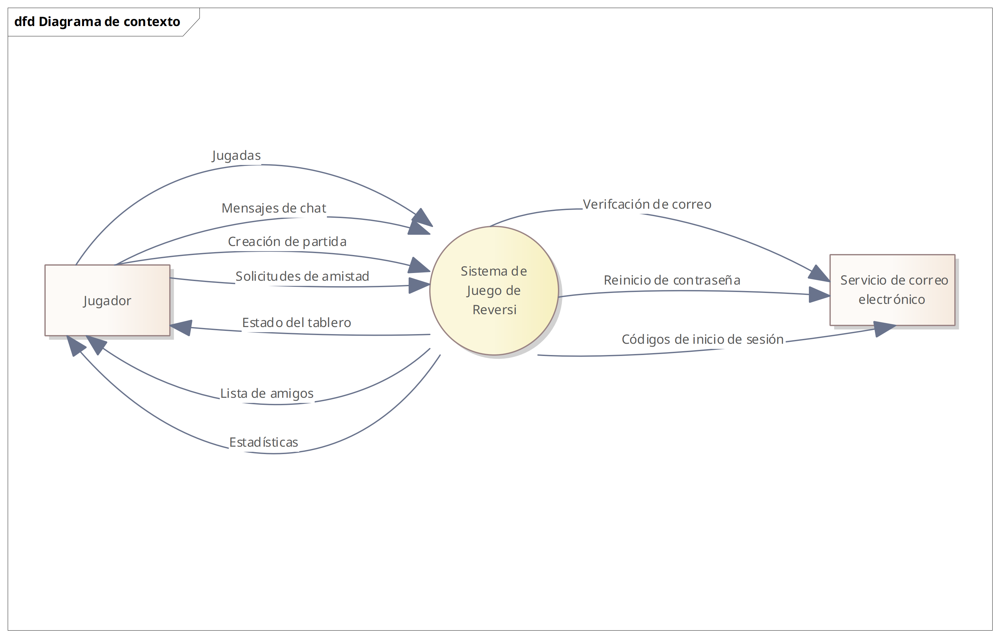
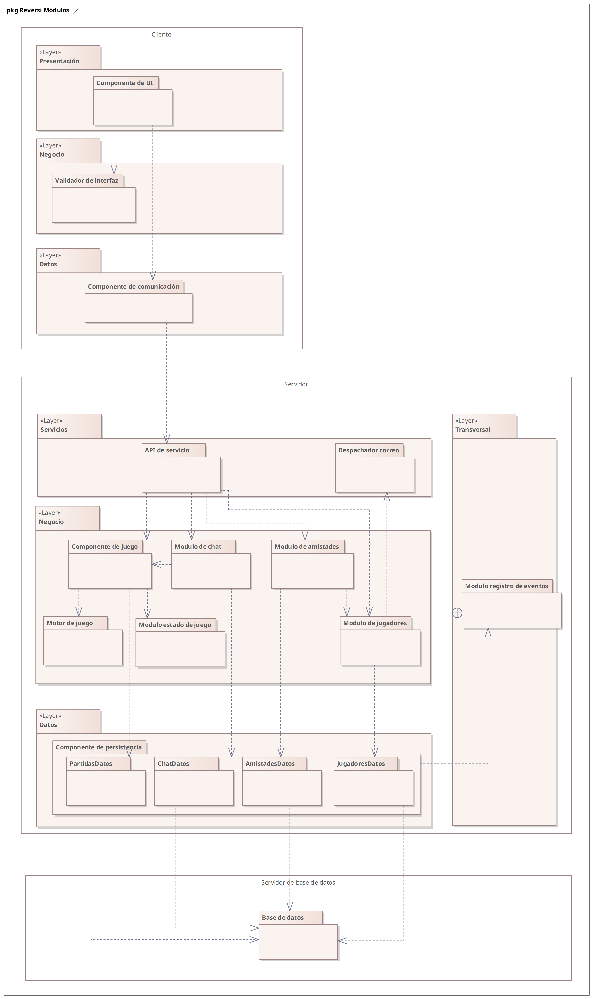

# Documento-Entrega

UNIVERSIDAD VERACRUZANA

FACULTAD DE ESTADÍSTICA E INFORMÁTICA

LICENCIATURA EN INGENIERÍA DE SOFTWARE

Diseño de Software

| Proyecto             | Reversi                         |
| -------------------- | ------------------------------- |
| Equipo e integrantes | César Daniel Ortega Castillejos Pedro Enrique Sánchez Rodríguez |
| Versión del documento | v0.1 |
| Entrega | Primera entrega |
| Fecha | 12/10/2026 |

# Documento de Arquitectura de Software (SAD)

---

## 1. Control y glosario

### 1.1 Control e historial

| Sistema | Reversi: Videojuego de estrategia por turnos con arquitectura cliente-servidor para partidas en línea de dos jugadores. |
| --- | --- |
| Propósito del documento | Permitir al lector evaluar la validez de los trade-offs técnicos seleccionados, implementar el cliente y el servidor de acuerdo con sus contratos e interfaces autoritativas, y planificar evoluciones del sistema. |
| Audiencia | Autoridad docente para evaluar la solidez y trazabilidad del diseño; equipo de desarrollo para guiar la construcción e integración de módulos; y testers (QA) para derivar las pruebas de verificación de los escenarios de calidad. |
| Alcance | Cubre el diseño integral del cliente de escritorio (WPF), el servidor autoritativo de partidas y sesiones (WCF) y la persistencia relacional (SQL Server). Quedan fuera del alcance el servicio de transporte de correo electrónico (dependencia externa), clientes web/móviles y el modo de juego local fuera de línea. |

| **Versión** | **Fecha** | **Cambios principales** |
| --- | --- | --- |
| v0.1 | 10/10/2026 | Primera entrega parcial: definición de frontera, interesados, drivers de calidad, árbol de utilidad, ASR prioritarios, decisiones ADR (001 a 006), catálogo de módulos C-01 a C-14, vistas V-01/V-02 y riesgos iniciales. |

### 1.2 Resumen de la arquitectura

El sistema Reversi es un juego distribuido por turnos para escritorio enfocado en garantizar la integridad absoluta de las partidas y una experiencia de usuario fluida con baja latencia.

Los principales drivers que gobiernan su estructura son la integridad del estado del juego (CON-01), la disponibilidad y tolerancia a fallos del servicio (CON-02, CON-04), y la usabilidad mediante retroalimentación inmediata sin saturar la red (ESC-05, ESC-07).

La solución adopta un estilo arquitectónico Cliente-Servidor autoritativo estructurado bajo un patrón de despliegue Three-Tier.

- El cliente de escritorio (WPF) implementa un validador ligero de movimientos para guiar visualmente la interacción del usuario sin esperar viajes de red.
- El servidor de aplicaciones (WCF) retiene la autoridad legal completa del reglamento a través de un motor de juego puro y sin estado, manteniendo las partidas activas en memoria RAM para asegurar respuestas sub-segundo y desacoplando la persistencia en disco de fallos transitorios mediante tácticas de degradación elegante y aislamiento (Bulkhead).
- La persistencia relacional reside en Microsoft SQL Server operando en un nivel de datos aislado. Los riesgos principales involucran la comprobación empírica de saturación bajo concurrencia y la prevención de discrepancias entre las reglas de la interfaz y las del servidor.

### 1.3 Glosario

| Término | Significado en este proyecto |
| --- | --- |
| Flanqueo | Regla de Reversi donde una ficha colocada atrapa una o más fichas enemigas en línea recta (horizontal, vertical o diagonal) entre sí y otra ficha del jugador actual, provocando su volteo. |
| Jugada válida | Acción realizada por un jugador durante el contexto de una partida al seleccionar una posición válida |
| Posición válida | Celda o casilla del tablero en donde el sistema permite realizar una jugada por ofrecer posibilidades de flanqueo |
| Jugador | Participante de una partida con la capacidad para realizar jugadas válidas |
| Partida | Encuentro entre dos (2) jugadores compuesto de jugadas válidas |

### 1.4 Uso de IA generativa

| Qué pidieron | Qué aceptaron y qué rechazaron | Cómo lo verificaron |
| --- | --- | --- |
| **Mejora de redacción apegada al dominio:** Redacción y pulido técnico de descripciones arquitectónicas, fichas de decisión (ADR), justificaciones de ASR y escenarios de calidad con terminología formal del dominio de Reversi y tácticas del SEI. | **Aceptado:** La terminología formal, la redacción neutral de caja negra en las respuestas de escenarios (eliminando fugas prematuras de solución) y los trade-offs de diseño.  **Rechazado:** Propuestas que sugerían tecnologías o mecanismos fuera del alcance y stack estipulado (tales como colas RabbitMQ o persistencia síncrona en cada turno). | Cotejo manual contra el glosario del proyecto (1.3), las restricciones técnicas formales (RES-TEC) y los términos de calidad del SEI / ISO 25010. |
| **Verificación de llenado correcto según reglas de la plantilla:** Auditoría de la estructura de las secciones de la primera entrega frente a las instrucciones de la plantilla SAD v5.0 y la lista de comprobación proporcionada. | **Aceptado:** El ajuste en la cantidad de elementos (10 escenarios, 6 ASR, 6 ADR), la inclusión de las filas obligatorias de seguridad (activo, actor, límite) y el formato tabular estricto de las fichas.  **Rechazado:** Formatos de redacción libre o listas desestructuradas que no respetaban las tablas canónicas de la plantilla. | Comparación punto por punto contra la lista de comprobación proporcionada de la plantilla y la rúbrica de evaluación docente. |
| **Verificación de identificadores permitidos en el documento:** Validación estricta del cumplimiento de la regla de los siete identificadores canónicos y trazabilidad entre secciones. | **Aceptado:** La corrección y eliminación de sub-abreviaciones inventadas (reemplazando `QAS-SEG` por la nomenclatura canónica `QAS-Seguridad`), y la unificación de los catálogos de componentes (`C-01` a `C-14`) y riesgos (`R-01` a `R-03`).  **Rechazado:** Cualquier prefijo intermedio que violara la regla de identificadores de la plantilla. | Rastreo y búsqueda en el texto para comprobar que solo existan los prefijos permitidos (QAS, ASR, ADR, C, V, EV, R) y que las referencias cruzadas entre secciones coincidan. |
| **Análisis y síntesis de avances de iteraciones:** Extracción y discriminación de la información técnica generada en las notas de las Iteraciones 1 a 5 de ADD para trasladar las decisiones esenciales a la entrega formal. | **Aceptado:** Sugerencias para la selección de decisiones arquitectónicas estructurales y la representación de la evolución histórica (marcando ADR-001 y ADR-002 como sustituidos por ADR-004 y ADR-005 tras la Iteración 5).  **Rechazado:** Trasladar decisiones de nivel de código, dependencias de bajo nivel o características descartadas (como el modo de juego fuera de línea). | Contraste contra las bitácoras de diseño de las Iteraciones 1 a 5 y los acuerdos de alcance establecidos con la autoridad organizacional. |

---

## 2. Drivers

### 2.1 Contexto y frontera

El sistema Reversi incluye el cliente de escritorio, los servicios remotos, la lógica de cuentas y partidas, el estado de las partidas activas y la persistencia relacional. El sistema permite gestionar jugadores, amistades, partidas, chat, estadísticas e historial. Los clientes se comunican con el servidor mediante contratos remotos, pero no tienen autoridad para modificar directamente el estado válido de las partidas.

Fuera de la frontera queda el proveedor externo de correo electrónico (DEP-01), que recibe solicitudes de envío generadas por el sistema.

La delimitación estructural y los actores externos se ilustran en la vista V-01.

### 2.2 Interesados y preocupaciones

| Interesado | Qué le preocupa |
| --- | --- |
| STK-01 Jugador | Disponer de partidas justas y confiables, recibir respuesta adecuada durante el juego, conservar su progreso y recuperarse de desconexiones breves. |
| STK-02 Equipo de desarrollo | Probar las reglas de forma aislada, localizar los cambios, controlar las dependencias y generar versiones distribuibles. |
| STK-05 Adversario | Manipular el cliente, enviar jugadas ilegales o intentar modificar información sin autorización. |
| STK-06 Autoridad organizacional | Cumplir el alcance, las tecnologías obligatorias, el calendario y la documentación de las decisiones arquitectónicas. |
| STK-07 Responsable del producto | Mantener las funciones prioritarias y una experiencia de juego adecuada dentro del tiempo disponible. |

### 2.3 Funciones clave

| Función (CU o HU) | ¿Arquitectónicamente significativa? | Por qué |
| --- | --- | --- |
| **CU-16 / HU-02: Realizar jugada** | **Sí** | **Estado compartido y concurrencia:** Requiere validar cada movimiento con el estado vigente de la partida, aplicar las reglas de flanqueo, conservar un único resultado válido y comunicar la actualización a ambos participantes en menos de 1 segundo. El servidor debe rechazar solicitudes ilegales o realizadas fuera de turno. |
| **HU-03: Controlar inactividad del turno** | **Sí** | **Comportamiento temporal:** Cada partida mantiene su propio tiempo de turno. Al agotarse el tiempo, el sistema debe seleccionar exactamente una posición válida, registrar la jugada automática y finalizar la partida cuando un jugador acumula tres agotamientos consecutivos. |
| **CU-11 / HU-01: Crear y coordinar sala de partida** | **Sí** | **Coordinación de estado distribuido:** Requiere crear una partida con un identificador único, registrar participantes remotos, mantener el estado de espera e iniciar el juego cuando se completa la sala. La opción para jugar contra el sistema está disponible desde que se muestra la pantalla de espera. |
| **CU-01 / RF-JUG-07: Registrar cuenta con verificación** | **Sí** | **Dependencia externa y consistencia:** Requiere comprobar la unicidad de los datos, generar y enviar un código temporal, validar el código y evitar la creación parcial de una cuenta cuando falla el correo o la persistencia. |
| **CU-26 / RF-SOC-01: Transmitir mensajes de chat en partida** | **Sí** | **Autorización y distribución concurrente:** Requiere comprobar que el jugador pertenece a la conversación, aplicar las reglas de moderación, almacenar el mensaje y comunicarlo a los participantes autorizados sin alterar el flujo de la partida. |
| **CU-09: Modificar idioma de la interfaz** | **Sí** | **Cambio de presentación:** Requiere cambiar los textos durante la ejecución, conservar la preferencia del jugador y evitar cambios en las reglas del juego o en los contratos de comunicación. |
| **CU-15: Unirse a partida mediante código** | **No** | Utiliza la estructura de creación, consulta y asignación de participantes definida para las partidas en espera. |
| **CU-05: Consultar perfil y estadísticas** | **No** | Es una operación de consulta que utiliza las responsabilidades generales de aplicación y persistencia. |
| **CU-21: Enviar solicitud de amistad** | **No** | Utiliza el flujo general de autorización, aplicación y persistencia sin introducir una estructura arquitectónica adicional. |
| **CU-28: Entrar como invitado** | **No** | Utiliza la estructura general de sesiones y la comunicación remota existente. |

### 2.4 Restricciones, supuestos y condiciones del negocio

| Tipo | Enunciado | Qué pasa si cambia o resulta falso |
| --- | --- | --- |
| **Restricción** | **RES-TEC-01:** La persistencia relacional debe implementarse utilizando Entity Framework. | Cambiar el mecanismo de acceso a datos obliga a sustituir las implementaciones de persistencia y revisar sus mapeos. |
| **Restricción** | **RES-TEC-02:** La comunicación remota entre el cliente y el servidor debe implementarse mediante Windows Communication Foundation (WCF). | Cambiar la tecnología de comunicación obliga a sustituir los contratos, los proxies y la configuración del canal remoto. |
| **Restricción** | **RES-TEC-03:** El cliente de escritorio debe desarrollarse con Windows Presentation Foundation (WPF) sobre el ecosistema .NET. | Exigir otra plataforma obliga a sustituir la presentación y revisar las capacidades disponibles para el cliente. |
| **Restricción** | **RES-TEC-04:** La persistencia relacional debe utilizar Microsoft SQL Server. | Cambiar el motor obliga a revisar el esquema, los tipos de datos, las consultas y la configuración de conexión. |
| **Condición de alcance** | El modo offline o local queda fuera del entregable principal para priorizar las partidas en línea. | Incorporarlo obliga a revisar la distribución de las reglas y las responsabilidades asignadas al cliente. |
| **Supuesto** | **ASM-02:** Se asume una carga base de 8 jugadores activos concurrentes, distribuidos en 4 partidas simultáneas de 2 jugadores. | Una carga mayor obliga a repetir las pruebas de capacidad y revisar la administración del estado, los recursos y la comunicación. |
| **Objetivo de negocio** | **OBJ-01:** Facilitar la adopción del juego reduciendo las barreras de acceso y aprendizaje. | Una experiencia difícil de comprender o iniciar puede reducir la incorporación de jugadores. |
| **Objetivo de negocio** | **OBJ-02:** Mantener una experiencia de juego confiable y consistente. | Los errores en el estado, las trampas o las interrupciones frecuentes pueden reducir la confianza de los jugadores. |
| **Condición organizacional** | **ORG-01 / ORG-02:** El proyecto es desarrollado por un equipo de dos personas dentro del periodo escolar asignado. | Un cambio en el tiempo o en la capacidad del equipo obliga a revisar el alcance y las prioridades. |
| **Condición organizacional** | **ORG-03:** El equipo realiza diseño, implementación, pruebas, documentación y despliegue sin equipos especializados independientes. | Las decisiones deben limitar la complejidad operativa y facilitar la comprobación del sistema por el mismo equipo. |

### 2.5 Escenarios de calidad y árbol de utilidad

#### Fichas de Escenarios de Calidad

| QAS-Seguridad-1 | Intento de realizar una jugada inválida |
| --- | --- |
| Fuente | STK-05 Adversario mediante un cliente modificado. |
| Estímulo | Solicita una jugada que viola las reglas, corresponde a otro turno o utiliza un estado desactualizado. |
| Entorno | Operación normal durante una partida en línea activa. |
| Artefacto | Estado de la partida y mecanismos responsables de procesar jugadas. |
| Respuesta | El sistema rechaza la solicitud y conserva el último estado válido de la partida. |
| Medida | El 100 % de las solicitudes identificadas como inválidas se rechazan sin colocar fichas, cambiar el turno, modificar el conteo ni persistir un movimiento. |
| Prioridad | (A, M) |
| Activo que se protege | Estado válido del tablero, turno, resultado e historial de la partida. |
| Actor de amenaza | Usuario con un cliente modificado o una solicitud de red adulterada. |
| Límite de confianza | Comunicación entre el cliente del jugador y el servidor que mantiene la autoridad de la partida. |

| QAS-Disponibilidad-1 | Recuperación ante desconexión temporal |
| --- | --- |
| Fuente | STK-01 Jugador que participa en una partida en línea. |
| Estímulo | Se interrumpe la comunicación del cliente durante una partida activa. |
| Entorno | Operación normal durante una partida en línea. |
| Artefacto | Sesión del jugador y estado de la partida. |
| Respuesta | El sistema conserva la partida durante el periodo permitido y reincorpora al jugador cuando restablece la conexión dentro de ese periodo. |
| Medida | Si la conexión se recupera en un máximo de 30 segundos, el jugador vuelve a la misma partida y recupera el último estado válido sin perder ni duplicar movimientos confirmados. |
| Prioridad | (A, A) |

| QAS-Disponibilidad-2 | Tolerancia a indisponibilidad de correo |
| --- | --- |
| Fuente | STK-01 Jugador que solicita una función que requiere el envío de correo. |
| Estímulo | El proveedor no responde o supera el tiempo permitido para completar el envío. |
| Entorno | Operación normal durante una función que requiere enviar un correo. |
| Artefacto | Comunicación con el proveedor externo de correo. |
| Respuesta | El sistema termina la operación de envío, informa el fallo al solicitante y permite que las operaciones no relacionadas con el correo continúen. |
| Medida | La operación de envío termina en un máximo de 5 segundos. Ninguna partida activa se cancela, se pausa o modifica su estado como consecuencia del fallo del proveedor. |
| Prioridad | (A, M) |

| QAS-Rendimiento-1 | Procesamiento y propagación de una jugada |
| --- | --- |
| Fuente | STK-01 Jugador en turno en una partida en línea. |
| Estímulo | Solicita realizar un movimiento válido durante su turno. |
| Entorno | Operación normal con hasta 8 jugadores activos concurrentes, distribuidos en 4 partidas simultáneas. |
| Artefacto | Procesamiento de jugadas y sincronización del estado de la partida. |
| Respuesta | El sistema valida la jugada, actualiza el estado y comunica el resultado a los dos participantes. |
| Medida | El tiempo desde la recepción de la solicitud hasta que el estado actualizado queda disponible para ambos jugadores es menor a 1 segundo en el 95 % de las jugadas. |
| Prioridad | (A, M) |

| QAS-Rendimiento-2 | Gestión de inactividad durante un turno |
| --- | --- |
| Fuente | STK-01 Jugador cuyo turno se encuentra activo. |
| Estímulo | Se alcanza el límite configurado sin que el jugador realice una jugada y existen posiciones válidas. |
| Entorno | Partida en línea activa. El tiempo predeterminado del turno es de 40 segundos. |
| Artefacto | Control temporal, reglas y estado de la partida. |
| Respuesta | El sistema selecciona una posición válida, realiza una jugada automática y registra el agotamiento del turno. |
| Medida | Se realiza exactamente 1 jugada automática válida. Al tercer turno consecutivo agotado, la partida termina con derrota del jugador inactivo. |
| Prioridad | (M, M) |

| QAS-Usabilidad-1 | Identificación y prevención de jugadas inválidas |
| --- | --- |
| Fuente | STK-01 Jugador durante su turno. |
| Estímulo | Explora el tablero e intenta seleccionar una posición inválida. |
| Entorno | Operación normal durante una partida activa en el turno del jugador. |
| Artefacto | Interfaz del tablero e información del estado actual de la partida. |
| Respuesta | La interfaz identifica las posiciones válidas e impide que una posición inválida genere una solicitud de jugada. |
| Medida | El indicador de posiciones válidas aparece en un máximo de 1 segundo. El 100 % de las posiciones inválidas identificadas por la interfaz quedan bloqueadas y no modifican el tablero ni el turno. |
| Prioridad | (M, B) |

| QAS-Usabilidad-2 | Disponibilidad de la partida contra el sistema |
| --- | --- |
| Fuente | STK-01 Jugador que crea una partida. |
| Estímulo | Entra a la pantalla de espera de un contrincante. |
| Entorno | Operación normal después de crear una partida. |
| Artefacto | Flujo de creación y espera de la partida. |
| Respuesta | El sistema muestra la opción para iniciar una partida contra un oponente controlado por el sistema desde el inicio de la espera. |
| Medida | La opción está disponible desde la primera presentación de la pantalla de espera, con 0 segundos de espera obligatoria. |
| Prioridad | (M, B) |

| QAS-FacilidadPrueba-1 | Prueba aislada y determinista de las reglas |
| --- | --- |
| Fuente | STK-02 Equipo de desarrollo. |
| Estímulo | Ejecuta la suite automatizada de reglas utilizando estados conocidos del tablero. |
| Entorno | Entorno de desarrollo y pruebas automatizadas. |
| Artefacto | Reglas de movimientos, flanqueos, turnos, inactividad y finalización. |
| Respuesta | La suite establece estados concretos, ejecuta los eventos definidos y permite observar de forma determinista el resultado. |
| Medida | El 100 % de la suite de reglas se ejecuta en menos de 5 segundos sin iniciar WPF, WCF, SQL Server, Entity Framework ni el proveedor de correo. |
| Prioridad | (A, M) |

| QAS-Modificabilidad-1 | Incorporación de un nuevo idioma |
| --- | --- |
| Fuente | STK-02 Equipo de desarrollo. |
| Estímulo | Se solicita incorporar un nuevo idioma a la interfaz. |
| Entorno | Desarrollo o mantenimiento de la aplicación. |
| Artefacto | Presentación y recursos de localización. |
| Respuesta | El equipo agrega los recursos del idioma sin modificar las reglas ni los contratos remotos. |
| Medida | El 100 % de los cambios se concentra en archivos de recursos, requiere 0 cambios en las reglas o contratos remotos y se completa en menos de 4 horas. |
| Prioridad | (A, M) |

| QAS-Desplegabilidad-1 | Empaquetado de una nueva versión |
| --- | --- |
| Fuente | STK-02 Equipo de desarrollo. |
| Estímulo | Ejecuta el proceso definido para generar los instaladores de una versión. |
| Entorno | Finalización de una versión del cliente y del servidor. |
| Artefacto | Proceso de compilación y empaquetado. |
| Respuesta | El proceso compila y genera los instaladores correspondientes a la misma versión. |
| Medida | La generación se inicia con 1 comando y requiere 0 pasos manuales adicionales durante la compilación y el empaquetado. |
| Prioridad | (M, M) |

---

#### Árbol de utilidad

| Atributo de calidad | Refinamiento | Identificador y escenario | Prioridad (Importancia, Dificultad) |
| --- | --- | --- | --- |
| Disponibilidad | Recuperabilidad | QAS-Disponibilidad-1: Recuperación ante desconexión temporal | (A, A) |
| Disponibilidad | Tolerancia a fallos | QAS-Disponibilidad-2: Tolerancia a indisponibilidad de correo | (A, M) |
| Seguridad | Integridad | QAS-Seguridad-1: Intento de realizar una jugada inválida | (A, M) |
| Rendimiento | Latencia | QAS-Rendimiento-1: Procesamiento y propagación de una jugada | (A, M) |
| Rendimiento | Comportamiento temporal | QAS-Rendimiento-2: Gestión de inactividad durante un turno | (M, M) |
| Usabilidad | Prevención de errores | QAS-Usabilidad-1: Identificación y prevención de jugadas inválidas | (M, B) |
| Usabilidad | Acceso a función | QAS-Usabilidad-2: Disponibilidad de la partida contra el sistema | (M, B) |
| Facilidad de prueba | Aislamiento y control | QAS-FacilidadPrueba-1: Prueba aislada y determinista de las reglas | (A, M) |
| Modificabilidad | Internacionalización | QAS-Modificabilidad-1: Incorporación de un nuevo idioma | (A, M) |
| Facilidad de despliegue | Automatización | QAS-Desplegabilidad-1: Empaquetado de una nueva versión | (M, M) |

### 2.6 ASR prioritarios

| ASR        | Qué debe cumplir la arquitectura                                                                                                                                                                                                                                                                                               | Procedencia                       | Viene de                         |
| ---------- | ------------------------------------------------------------------------------------------------------------------------------------------------------------------------------------------------------------------------------------------------------------------------------------------------------------------------------ | --------------------------------- | -------------------------------- |
| **ASR-01** | La arquitectura debe mantener en el servidor la autoridad sobre el estado legal de cada partida. El servidor debe validar la regla, el turno y el estado vigente de cada movimiento. El 100 % de las solicitudes identificadas como inválidas debe rechazarse sin colocar fichas, cambiar el turno ni persistir un movimiento. | Función y escenario de calidad    | CU-16 / HU-02 y QAS-Seguridad-1  |
| **ASR-02** | La arquitectura debe conservar durante 30 segundos la sesión y el estado necesarios para reincorporar a un jugador desconectado. Si el jugador regresa dentro de ese periodo, debe recuperar la misma partida y el último estado válido sin pérdida ni duplicación de movimientos confirmados.                                 | Escenario de calidad              | QAS-Disponibilidad-1             |
| **ASR-03** | La arquitectura debe procesar una jugada válida y poner el estado actualizado a disposición de ambos participantes en menos de 1 segundo en el 95 % de los casos. Esta medida aplica con hasta 8 jugadores concurrentes distribuidos en 4 partidas simultáneas.                                                                | Escenario de calidad y supuesto   | QAS-Rendimiento-1 y ASM-02       |
| **ASR-04** | La arquitectura debe aislar la comunicación con el proveedor externo de correo. Cuando el proveedor no responda, la operación debe terminar en un máximo de 5 segundos e informar el fallo sin cancelar, pausar ni modificar partidas activas.                                                                                 | Escenario de calidad              | QAS-Disponibilidad-2             |
| **ASR-05** | La arquitectura debe organizar el sistema como una aplicación distribuida con un cliente de escritorio WPF y un servidor WCF. La comunicación debe realizarse mediante contratos remotos definidos y el cliente no debe acceder directamente a la lógica ni a la persistencia del servidor.                                    | Restricción                       | RES-TEC-02 y RES-TEC-03          |
| **ASR-06** | La arquitectura debe permitir que el cliente identifique las posiciones válidas en un máximo de 1 segundo y bloquee el 100 % de las posiciones que reconoce como inválidas antes de enviar una solicitud. Esta comprobación en el cliente no sustituye la validación definitiva del servidor.                                  | Función y escenario de calidad    | CU-16 / HU-02 y QAS-Usabilidad-1 |
| **ASR-07** | La arquitectura debe permitir ejecutar el 100 % de la suite automatizada de reglas en menos de 5 segundos. La suite debe controlar los estados de prueba y ejecutarse sin iniciar WPF, WCF, SQL Server, Entity Framework ni el proveedor externo de correo.                                                                    | Interesado y escenario de calidad | STK-02 y QAS-FacilidadPrueba-1   |

QAS-Desplegabilidad-1 se conserva como escenario planeado para la Iteración 4. No forma parte de los ASR prioritarios de esta entrega.

---

## 3. Decisiones

### 3.1 Índice de decisiones

| ADR | Decisión | Estado | ASR que atiende |
| --- | --- | --- | --- |
| **ADR-001** | Adopción de patrón de despliegue Two-Tier para cliente y servidor | Sustituido por ADR-004 | ASR-05 |
| **ADR-002** | Distribución de reglas mediante biblioteca compartida entre cliente y servidor | Sustituido por ADR-005 | ASR-01, ASR-06 |
| **ADR-003** | Selección de Windows Communication Foundation (WCF) como tecnología de comunicación remota | Aceptado | ASR-05 |
| **ADR-004** | Adopción de patrón de despliegue Three-Tier con nivel de base de datos aislado | Aceptado | ASR-05 |
| **ADR-005** | Desacoplamiento de reglas mediante Servidor Autoritativo y Validador Ligero en Cliente | Aceptado | ASR-01, ASR-06 |
| **ADR-006** | Gestión de estado de partidas activas en memoria RAM con aislamiento de persistencia (Bulkhead) | Aceptado | ASR-02, ASR-03 |

### 3.2 Fichas de decisión

| ADR-001 | Adopción de patrón de despliegue Two-Tier para cliente y servidor |
| --- | --- |
| **Estado** | Sustituido por ADR-004 |
| **Contexto** | Se requería definir la distribución física inicial de la aplicación distribuida para dar soporte a la comunicación remota (ASR-05) con una configuración sencilla para dos desarrolladores. |
| **Alternativas** | **A (Two-Tier):** Nodo cliente ejecutando la aplicación de escritorio y nodo servidor alojando el host del servicio WCF junto con la base de datos SQL Server compartiendo el mismo entorno físico. *A favor:* Configuración inicial rápida y menor esfuerzo de administración de red. *En contra:* Acoplamiento físico del proceso de servicio con el motor de base de datos; contención de recursos de máquina.  **B (Three-Tier):** Separación física en tres niveles independientes (Cliente, Servidor de aplicaciones y Base de datos aislada). *A favor:* Aislamiento de fallos y preparación para despliegues independientes. *En contra:* Mayor sobrecarga de configuración de red y entornos para la etapa inicial. |
| **Criterios** | Simplicidad operativa inicial frente a desacoplamiento de infraestructura. |
| **Decisión** | Se adoptó inicialmente la Alternativa A (Two-Tier) para reducir la fricción inicial de configuración. |
| **Consecuencias** | Permitió iniciar el proyecto rápidamente, pero acopló el servicio al motor de base de datos. Fue sustituida en ADR-004 tras la revisión de alcance y evaluación de la arquitectura. |
| **Riesgos** | R-03 |
| **Elementos afectados** | C-04, C-12, C-14 |

| ADR-002 | Distribución de reglas mediante biblioteca compartida entre cliente y servidor |
| --- | --- |
| **Estado** | Sustituido por ADR-005 |
| **Contexto** | Se debía determinar cómo distribuir la lógica de Reversi para validar jugadas en el servidor (ASR-01) y proveer retroalimentación de casillas válidas en la interfaz del cliente (ASR-06). |
| **Alternativas** | **A (Biblioteca binaria compartida .dll):** Compilar el motor de reglas en una biblioteca común referenciada tanto por el proyecto de cliente como por el de servidor. *A favor:* Cero duplicación de código; un único punto de mantenimiento para el reglamento. *En contra:* Acoplamiento binario estrecho; cualquier cambio obliga a recompilar y desplegar sincronizadamente ambos extremos.  **B (Validación remota por red):** El cliente carece de reglas y consulta al servidor por red cada casilla sobre la que se mueve el cursor. *A favor:* Desacoplamiento total del cliente respecto al reglamento. *En contra:* Introduce latencia en la interfaz visual y satura la red con consultas innecesarias de casillas. |
| **Criterios** | Reutilización de código frente a independencia de despliegue y desacoplamiento binario. |
| **Decisión** | Se eligió inicialmente la Alternativa A (Biblioteca compartida). |
| **Consecuencias** | Centralizaba las reglas, pero ataba los ciclos de publicación del cliente y servidor. Fue sustituida en ADR-005 para favorecer la independencia de despliegue y la pre-validación de interfaz. |
| **Riesgos** | R-02 |
| **Elementos afectados** | C-01, C-02, C-05, C-06 |

| ADR-003 | Selección de Windows Communication Foundation (WCF) como tecnología de comunicación remota |
| --- | --- |
| **Estado** | Aceptado |
| **Contexto** | El sistema requiere un canal de comunicación remota cliente-servidor bajo .NET que satisfaga la restricción tecnológica obligatoria y permita invocar operaciones y sincronizar estados (ASR-05 / RES-TEC-02). |
| **Alternativas** | **A (Windows Communication Foundation - WCF):** Framework nativo de comunicación RPC en .NET con soporte de contratos fuertemente tipados (ServiceContract) y enlaces orientados a conexión (NetTcpBinding). *A favor:* Cumple directamente con RES-TEC-02; integración transparente con WPF en C#; manejo nativo de sesiones. *En contra:* Tecnología legacy con menor interoperabilidad fuera del ecosistema .NET Framework.  **B (gRPC sobre HTTP/2):** Framework moderno de alto rendimiento basado en buffers de protocolo. *A favor:* Serialización binaria eficiente y estándar contemporáneo en la industria. *En contra:* Requiere configuración externa adicional y se desvía del stack técnico formalmente estipulado. |
| **Criterios** | Cumplimiento de la restricción tecnológica impuesta (RES-TEC-02) y compatibilidad con el cliente WPF. |
| **Decisión** | Se elige la Alternativa A (WCF) empleando enlaces TCP para comunicación remota de baja sobrecarga. |
| **Consecuencias** | Se asegura plena compatibilidad con el entorno de desarrollo y contratos tipados. Se asume la dependencia tecnológica con el ecosistema de comunicación de .NET Framework. |
| **Riesgos** | R-03 |
| **Elementos afectados** | C-03, C-04 |

| ADR-004 | Adopción de patrón de despliegue Three-Tier con nivel de base de datos aislado |
| --- | --- |
| **Estado** | Aceptado (Sustituye a ADR-001) |
| **Contexto** | Se requiere estructurar la arquitectura en tres niveles formales para aislar el cómputo de partidas respecto a la persistencia y preparar el sistema para pruebas de concurrencia independientes (ASR-05). |
| **Alternativas** | **A (Three-Tier con motor relacional aislado):** El cliente WPF opera en el dispositivo del usuario, el servidor WCF procesa partidas en un nodo de aplicación, y Microsoft SQL Server opera en un nivel de datos aislado (contenedorizado). *A favor:* Aislamiento de consumo de CPU/RAM entre base de datos y servidor de juego; modularidad física para reproducir entornos de prueba limpios. *En contra:* Requiere configurar y mantener la conexión de red y credenciales entre el contenedor y el host de servicios.  **B (Two-Tier mantenido):** Continuar con SQL Server instalado de forma compartida en el mismo host que WCF. *A favor:* Evita administrar contenedores o enlaces de red adicionales. *En contra:* No cumple con la separación de niveles evaluable ni protege al servidor WCF de saturación por bloqueos en el motor relacional. |
| **Criterios** | Aislamiento de fallos, desacoplamiento físico de persistencia y directrices de evaluación del sistema. |
| **Decisión** | Se elige la Alternativa A (Three-Tier), aislando la base de datos relacional en su propio contenedor. |
| **Consecuencias** | Se independiza la infraestructura de datos y se elimina la contención de recursos en el servidor de juego. Se asume la administración del contenedor y su red interna. |
| **Riesgos** | R-03 |
| **Elementos afectados** | C-04, C-08, C-09 |

| ADR-005 | Desacoplamiento de reglas mediante Servidor Autoritativo y Validador Ligero en Cliente |
| --- | --- |
| **Estado** | Aceptado (Sustituye a ADR-002) |
| **Contexto** | Es obligatorio proteger el juego contra clientes adulterados (ASR-01) y proveer retroalimentación visual inmediata al usuario sin enviar jugadas inválidas por la red (ASR-06), eliminando el acoplamiento binario de dependencias compartidas. |
| **Alternativas** | **A (Servidor Autoritativo con Validador Ligero en Cliente y duplicación deliberada):** El servidor concentra el Motor de Juego autoritativo completo (validación, flanqueo, turnos y fin de juego). El cliente integra un Validador Ligero independiente que solo evalúa casillas admisibles a partir de su tablero local para responder al cursor del usuario y filtrar selecciones ilegales antes de transmitirlas. *A favor:* Elimina el acoplamiento binario entre cliente y servidor; provee respuesta visual en menos de 50 ms (ASR-06); reduce el tráfico de red al descartar clics erróneos en el cliente; el servidor retiene la autoridad legal absoluta ante cualquier modificación no autorizada (ASR-01). *En contra:* Duplicación deliberada de la lógica básica de comprobación de casillas; requiere sincronización manual en ambos módulos si las reglas cambian.  **B (Mantener biblioteca binaria compartida DLL):** Distribuir la misma DLL compilada a ambos proyectos. *A favor:* Evita duplicación de código. *En contra:* Provoca acoplamiento de compilación y empaquetado; expone la lógica interna completa del servidor en el binario del cliente. |
| **Criterios** | Seguridad e integridad del juego (ASR-01), usabilidad y rendimiento de red (ASR-06) e independencia de artefactos. |
| **Decisión** | Se elige la Alternativa A, aceptando conscientemente la duplicación deliberada de la validación básica en pro del desacoplamiento y el rendimiento de red. |
| **Consecuencias** | Interfaz rápida sin latencia de red para el jugador y validación segura en el servidor. Se asume el compromiso de mantener alineadas ambas implementaciones ante evoluciones del reglamento. |
| **Riesgos** | R-02 |
| **Elementos afectados** | C-01, C-02, C-05, C-06 |

| ADR-006 | Gestión de estado de partidas activas en memoria RAM con aislamiento de persistencia (Bulkhead) |
| --- | --- |
| **Estado** | Aceptado |
| **Contexto** | Se debe garantizar la propagación de movimientos en menos de 1 segundo bajo concurrencia (ASR-03) y preservar partidas ante caídas temporales de red (ASR-02), sin que contingencias en el acceso a datos interrumpan las partidas. |
| **Alternativas** | **A (Estado en memoria RAM con persistencia asíncrona y mamparas Bulkhead):** Las partidas activas se mantienen y operan en la memoria RAM del servidor. La persistencia hacia SQL Server se ejecuta de forma asíncrona mediante submódulos aislados por área funcional (PartidaDatos, ChatDatos, JugadoresDatos). *A favor:* Permite latencia sub-segundo en partidas activas; si la base de datos presenta lentitud temporal, las partidas activas no se congelan (Degradación Elegante); las operaciones de chat o auditoría no saturan las conexiones de las partidas. *En contra:* Una interrupción abrupta de energía en el proceso de servidor provocaría la pérdida de jugadas que no alcanzaron a volcarse a disco.  **B (Persistencia síncrona transaccional en cada jugada):** Cada movimiento abre y bloquea una transacción directa en SQL Server antes de notificar el nuevo estado a los jugadores. *A favor:* Consistencia inmediata e inmutable en disco ante cualquier apagón. *En contra:* Cualquier bloqueo, contención o latencia en el motor relacional congela la partida, violando el tiempo de respuesta requerido. |
| **Criterios** | Latencia de propagación (ASR-03), resiliencia de juego (ASR-02) y aislamiento de fallos. |
| **Decisión** | Se elige la Alternativa A, aplicando las tácticas de *Degradación Elegante* y *Mamparas (Bulkhead)* mediante el Módulo de Estado de Juego en memoria y persistencia especializada. |
| **Consecuencias** | Se maximiza la disponibilidad y fluidez de las partidas en tiempo real. Se acepta el riesgo residual de pérdida de estado volátil ante caídas repentinas del proceso del servidor. |
| **Riesgos** | R-01 |
| **Elementos afectados** | C-05, C-07, C-12 |

---

## 4. Estructura y componentes

### 4.1 Catálogo de elementos

#### Reglas generales de dependencia permitidas:

1. **Aislamiento de niveles:** El Tier Cliente sólo interactúa con el Tier Servidor a través del canal de red entre `C-03` y `C-04`. Ningún elemento del cliente puede referenciar componentes internos de negocio o persistencia del servidor.
2. **Flujo unidireccional en servidor:** La fachada de entrada (`C-04`) invoca los módulos de lógica de negocio (`C-05`, `C-08`, `C-09`, `C-10`). La lógica de negocio consume la persistencia (`C-12`) y el soporte (`C-11`, `C-13`).
3. **Pureza de las reglas y estado:** El motor de juego (`C-06`) y el estado en memoria (`C-07`) son componentes puros sin dependencias hacia persistencia, servicios de red ni interfaces de usuario.
4. **Acceso exclusivo a datos:** El servidor de base de datos (`C-14`) sólo puede ser accedido por el componente de persistencia (`C-12`).

---

| Elemento | Qué hace | Qué no hace | De quién depende |
| --- | --- | --- | --- |
| **Tier Cliente (Escritorio WPF)** |  |  |  |
| **C-01 Componente de UI** | Renderiza tableros, menús interactivos, animaciones y ventanas de chat; captura eventos de usuario y muestra casillas sugeridas. | No calcula el nuevo estado legal definitivo del tablero ni ejecuta consultas a bases de datos. | C-02, C-03 |
| **C-02 Validador de interfaz** | Analiza la matriz del tablero local para pre-validar movimientos válidos en tiempo real (\le 50 ms) y bloquear clics erróneos en la interfaz. | No aplica el volteo final de fichas, no cambia turnos ni emite veredictos de victoria/derrota. | Ninguno (Lógica de presentación pura) |
| **C-03 Componente de comunicación** | Gestiona la conexión de red como cliente WCF; serializa solicitudes, invoca operaciones remotas y escucha callbacks del servidor. | No implementa lógica de interfaz de usuario ni procesa reglas de juego. | C-04 (Vía canal de red WCF) |
| **Tier Servidor (Servicios y Negocio WCF)** |  |  |  |
| **C-04 API de servicio** | Expone los contratos de servicio WCF (ServiceContracts), autentica peticiones remotas y despacha las invocaciones a la lógica correspondiente. | No contiene lógica de reglas de Reversi ni interactúa directamente con el motor de base de datos. | C-05, C-08, C-09, C-10, C-13 |
| **C-05 Componente de juego** | Orquesta el ciclo de vida de salas, sincroniza turnos entre jugadores, controla los temporizadores de inactividad (40 s) y ejecuta el oponente automatizado (bot). | No dictamina si una jugada cumple el reglamento de flanqueo ni realiza consultas SQL directas. | C-06, C-07, C-12, C-13 |
| **C-06 Motor de juego** | Entidad autoritativa que valida legalidad de movimientos, calcula el flanqueo y volteo de piezas, y dictamina fin de partida o empate según el reglamento de Reversi. | No mantiene conexiones de red, no gestiona sesiones ni accede a la base de datos o sistema de archivos. | Ninguno (Lógica pura independiente) |
| **C-07 Módulo de estado de juego** | Mantiene en memoria RAM las estructuras del tablero, participantes y reloj de las partidas activas (hasta 4 concurrentes) para respuestas sub-segundo. | No persiste información en disco ni valida la legalidad de las jugadas. | Ninguno |
| **C-08 Módulo de jugadores** | Gestiona la autenticación, altas de cuentas, sesiones activas, perfiles de usuario y cómputo de estadísticas de juego. | No administra las salas de juego activas ni envía mensajes de correo directamente. | C-11, C-12, C-13 |
| **C-09 Módulo de amistades** | Administra la lista de contactos, solicitudes de amistad entrantes/salientes y estado de conexión social de los jugadores. | No interviene en el flujo de partidas activas ni en el chat de juego. | C-12, C-13 |
| **C-10 Módulo de chat** | Recibe, valida formato y distribuye mensajes de texto entre los participantes de una sala de partida en curso. | No almacena estado en memoria permanente ni gestiona turnos de juego. | C-12, C-13 |
| **C-11 Despachador correo** | Coordina el envío de códigos de verificación temporal aplicando Fail-Fast con límite estricto de 5 s ante fallos del proveedor SMTP externo. | No almacena credenciales de usuario ni bloquea las partidas activas si el proveedor externo falla. | C-13 (Consume proveedor SMTP externo DEP-01) |
| **C-12 Componente de persistencia** | Encapsula el acceso a datos mediante Entity Framework aplicando aislamiento de mamparas (Bulkhead: PartidaDatos, JugadoresDatos, etc.). | No contiene reglas del juego ni procesa validaciones de interfaz de usuario. | C-14, C-13 |
| **C-13 Módulo registro de eventos** | Registra de forma transversal errores del sistema, advertencias, caídas transitorias y auditoría de seguridad en archivos de registro locales. | No procesa peticiones de usuarios ni gestiona estados de negocio. | Ninguno (Escribe directamente en el sistema de archivos local) |
| **Tier de Datos (Persistencia Relacional)** |  |  |  |
| **C-14 Servidor de base de datos** | Instancia de Microsoft SQL Server que asegura la consistencia, integridad referencial y almacenamiento persistente del esquema relacional. | No ejecuta lógica de aplicación ni contiene reglas de negocio de Reversi. | Ninguno |

### 4.2 Interfaces críticas

*Entrega final*

Sólo las interfaces cuyo incumplimiento produce un riesgo real: dinero, estado compartido, datos personales…

| Interfaz | Provista por / usada por | Operaciones | Contrato: condiciones de entrada, resultado garantizado y errores relevantes |
| --- | --- | --- | --- |
| [Nombre] | [C-_ / C-_] | […] | […] |

### 4.3 Reglas de dependencia

*Entrega final*

| Regla | Permitida o prohibida | Por qué (ADR) |
| --- | --- | --- |
| […] | […] | [ADR-_] |

---

## 5. Arquitectura en ejecución

*Entrega final*

Cada preocupación tiene una decisión, o un «no aplica» con su razón. No es una lista de tecnologías: toda tecnología mencionada se conecta con un ADR o un ASR.

| Preocupación | Decisión, o «no aplica porque…» | ADR / ASR | Vista o evidencia |
| --- | --- | --- | --- |
| Distribución y comunicación | […] | […] | [V-_ / EV-_] |
| Datos, estado y propiedad | […] | […] | [V-_ / EV-_] |
| Concurrencia y coordinación | […] | […] | [V-_ / EV-_] |
| Resiliencia y disponibilidad | […] | […] | [V-_ / EV-_] |
| Seguridad y límites de confianza | […] | […] | [V-_ / EV-_] |
| Despliegue y entornos | […] | […] | [V-_ / EV-_] |
| Observabilidad y operación | […] | […] | [V-_ / EV-_] |
| Costo operacional | […] | […] | [V-_ / EV-_] |

---

## 6. Vistas

### 6.1 Tipos de vista que usaremos

| Tipo de vista | Qué preocupaciones atiende |
| --- | --- |
| Contexto | Frontera del sistema, usuarios y sistemas externos |
| Estructura | Módulos, componentes, interfaces y dependencias |
| Ejecución | Interacciones, estado compartido, concurrencia y fallas |
| Despliegue | Nodos, comunicación, límites de confianza y redundancia |

### 6.2 Vistas

**Índice de vistas**

| Vista | Nombre | Tipo de vista | Qué muestra | Decisión que refleja |
| --- | --- | --- | --- | --- |
| **V-01** | Vista de contexto del sistema | Contexto | Delimitación de la frontera del sistema Reversi, actores humanos y servicios externos con los que interactúa. | ADR-003, ADR-006 |
| **V-02** | Vista de estructura de módulos | Módulos / Estructura | Descomposición del sistema en componentes a través de los tres tiers, límites de responsabilidad y dependencias permitidas. | ADR-004, ADR-005, ADR-006 |

---

| V-01 Vista de contexto del sistema |  |
| --- | --- |
| **Tipo de vista** | Contexto |
| **Para quién y para qué** | **Evaluadores y docente:** Para verificar los límites operacionales del sistema Reversi y distinguir qué elementos quedan bajo el control de la aplicación frente a entidades externas.  **Equipo de desarrollo:** Para identificar los canales de entrada/salida y las interfaces con actores humanos y dependencias externas. |
| **Preocupaciones que atiende** | Delimitación clara de la frontera del sistema, identificación de los actores externos (jugador/rival) y desacoplamiento de servicios externos no confiables (servidor SMTP). |
| **Notación y leyenda** | Diagrama de contexto tipo C4 (Nivel 1). Bloque central delimitando la frontera del Sistema Reversi; cajas externas para actores humanos y servicios externos (DEP-01); flechas dirigidas rotuladas indicando el sentido de los mensajes. |
| **Se corresponde con** | V:01 Sistema de Juego de Reversi es todo V-02. |

---

| V-02 Vista de estructura de módulos |  |
| --- | --- |
| **Tipo de vista** | Estructura |
| **Para quién y para qué** | **Equipo de desarrollo:** Para conocer la descomposición del software en componentes (C-01 a C-14), los límites de cada tier y las reglas de dependencia permitidas al implementar y estructurar el código.  **Evaluadores y QA:** Para verificar la separación de responsabilidades, la autoría única de las reglas de juego y el desacoplamiento físico de la persistencia. |
| **Preocupaciones que atiende** | Modularidad, autoridad del motor de juego frente a trampas (ASR-01), respuestas visuales sin latencia de red (ASR-06), aislamiento de fallos en persistencia (Mamparas / Bulkhead en C-12) y arquitectura de despliegue Three-Tier (ADR-004). |
| **Notación y leyenda** | Diagrama de módulos y paquetes UML. Cajas agrupadas por niveles (Tier Cliente, Tier Servidor de Aplicaciones y Tier de Datos); flechas dirigidas continuas (`-->`) que representan dependencias de uso/invocación permitidas. |
| **Se corresponde con** | V-02 completo es V-01: Sistema de Juego de Reversi. |

---

## 7. Evaluación, trazabilidad y transición

### 7.1 Evaluación y trazabilidad de los ASR

*Entrega final*

Una fila por ASR. Esta tabla es la matriz de trazabilidad: no la repitan en otro lugar. En «Resultado» no escriban sólo «cumple»: digan qué mostró la evidencia.

| ASR | ADR | Elementos | Vista | Evidencia | Resultado | Riesgo residual |
| --- | --- | --- | --- | --- | --- | --- |
| ASR-01 | […] | […] | V-_ | [EV-_] | [Qué mostró la evidencia] | [R-_] |

### 7.2 Evidencias

*Entrega final*

Registren aquí cada EV que citen. Una evidencia puede ser una revisión por escenario, una medición, una prueba o un análisis. Es obligatorio incluir al menos una verificación empírica ejecutada y una comprobación de conformidad.

| EV | Tipo | Qué se hizo y qué resultó | Archivo o referencia |
| --- | --- | --- | --- |
| EV-01 | [Revisión / Medición / Prueba / Análisis] | […] | [evidencia/…] |

#### Verificación empírica. EV-_

| Verificación empírica. EV-_ |  |
| --- | --- |
| Afirmación que se pone a prueba | [Qué esperan de la arquitectura] |
| Cómo se probó | [Prototipo pequeño (spike), medición o prueba; condiciones] |
| Resultado | [Qué se observó, con números] |
| Qué cambia en la arquitectura | [Se confirma, se matiza o se refuta; ajuste realizado] |

*No necesitan construir el sistema completo: un prototipo pequeño basta si pone a prueba la afirmación.*

#### Comprobación de conformidad. EV-_

| Comprobación de conformidad. EV-_ |  |
| --- | --- |
| Decisión que protege | [ADR o regla de dependencia] |
| Procedimiento | [Pasos que otra persona puede repetir. Automatizarlo es deseable, no obligatorio] |
| Resultado esperado | [Cuándo se considera que la regla se violó] |

### 7.3 Riesgos y pendientes

| R | Tipo | Descripción | Qué se hará |
| --- | --- | --- | --- |
| **R-01** | Riesgo | Mantener el estado activo de las partidas en la memoria RAM del servidor sin persistencia transaccional síncrona en disco (ADR-006). Ante una caída inesperada del proceso del host o fallo de energía, se pierde el progreso de las partidas en curso no concluidas. | Registrar eventos clave en el log de auditoría local (C-13) y ejecutar pruebas de corte forzado de proceso durante la fase de integración para validar el comportamiento residual. |
| **R-02** | Deuda | Duplicación deliberada de la comprobación básica de casillas entre el cliente WPF y el servidor WCF (ADR-005). Existe riesgo de divergencia (rule drift): la interfaz podría habilitar casillas que el servidor luego rechace si no se mantienen sincronizados ambos módulos ante futuras modificaciones. | Definir una batería idéntica de pruebas unitarias automatizadas (QAS-Verificabilidad) para validar la misma matriz de jugadas sobre el validador del cliente y el motor del servidor antes del cierre de versión. |
| **R-03** | Pendiente | Comunicación remota por TCP entre el servidor WCF y el contenedor de Microsoft SQL Server (ADR-004) bajo la concurrencia operativa de 8 jugadores (ASM-02). Existe riesgo de latencia acumulada o agotamiento del pool de conexiones durante picos simultáneos de chat y perfiles. | Aplicar aislamiento mediante DbContexts independientes por área funcional (Bulkhead en C-12) y verificar tiempos de respuesta con pruebas de carga de 8 jugadores concurrentes en la segunda entrega. |

### 7.4 Transición a Construcción

*Entrega final*

Instrucciones accionables para quien implemente: decisiones que no deben romperse, interfaces críticas, comprobaciones que deben ejecutarse y orden sugerido de trabajo. Si ya hay código, registren las diferencias con el diseño; si no, cómo se comprobarán.

[Guía breve.]

| Elemento o ADR | Qué dice el diseño | Qué hay en el código, o cómo se comprobará | Qué se hará |
| --- | --- | --- | --- |
| [ADR / C] | […] | […] | […] |

---
