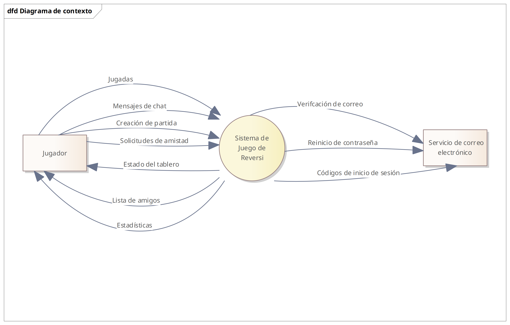
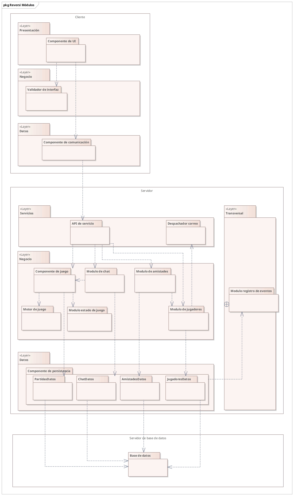

# Documento-Entrega

UNIVERSIDAD VERACRUZANA

FACULTAD DE ESTADÍSTICA E INFORMÁTICA

LICENCIATURA EN INGENIERÍA DE SOFTWARE

Diseño de Software

| Proyecto | Reversi |
| --- | --- |
| Equipo e integrantes | César Daniel Ortega Castillejos 
Pedro Enrique Sánchez Rodríguez |
| Versión del documento | v0.1 |
| Entrega | Primera entrega |
| Fecha | 12/10/2026 |

# Documento de Arquitectura de Software (SAD)

---

## 1. Control y glosario

### 1.1 Control e historial

| Sistema | Reversi: Videojuego de estrategia por turnos con arquitectura cliente-servidor para partidas en línea de dos jugadores. |
| --- | --- |
| Propósito del documento | Permitir al lector evaluar la validez de los trade-offs técnicos seleccionados, implementar el cliente y el servidor de acuerdo con sus contratos e interfaces autoritativas, y planificar evoluciones del sistema. |
| Audiencia | Autoridad docente para evaluar la solidez y trazabilidad del diseño; equipo de desarrollo para guiar la construcción e integración de módulos; y testers (QA) para derivar las pruebas de verificación de los escenarios de calidad. |
| Alcance | Cubre el diseño integral del cliente de escritorio (WPF), el servidor autoritativo de partidas y sesiones (WCF) y la persistencia relacional (SQL Server). Quedan fuera del alcance el servicio de transporte de correo electrónico (dependencia externa), clientes web/móviles y el modo de juego local fuera de línea. |

| **Versión** | **Fecha** | **Cambios principales** |
| --- | --- | --- |
| v0.1 | 10/10/2026 | Primera entrega parcial: definición de frontera, interesados, drivers de calidad, árbol de utilidad, ASR prioritarios, decisiones ADR (001 a 006), catálogo de módulos C-01 a C-14, vistas V-01/V-02 y riesgos iniciales. |

### 1.2 Resumen de la arquitectura

El sistema Reversi es un juego distribuido por turnos para escritorio enfocado en garantizar la integridad absoluta de las partidas y una experiencia de usuario fluida con baja latencia.

Los principales drivers que gobiernan su estructura son la integridad del estado del juego (CON-01), la disponibilidad y tolerancia a fallos del servicio (CON-02, CON-04), y la usabilidad mediante retroalimentación inmediata sin saturar la red (ESC-05, ESC-07).

La solución adopta un estilo arquitectónico Cliente-Servidor autoritativo estructurado bajo un patrón de despliegue Three-Tier.

- El cliente de escritorio (WPF) implementa un validador ligero de movimientos para guiar visualmente la interacción del usuario sin esperar viajes de red.
- El servidor de aplicaciones (WCF) retiene la autoridad legal completa del reglamento a través de un motor de juego puro y sin estado, manteniendo las partidas activas en memoria RAM para asegurar respuestas sub-segundo y desacoplando la persistencia en disco de fallos transitorios mediante tácticas de degradación elegante y aislamiento (Bulkhead).
- La persistencia relacional reside en Microsoft SQL Server operando en un nivel de datos aislado. Los riesgos principales involucran la comprobación empírica de saturación bajo concurrencia y la prevención de discrepancias entre las reglas de la interfaz y las del servidor.

### 1.3 Glosario

| Término | Significado en este proyecto |
| --- | --- |
| Flanqueo | Regla de Reversi donde una ficha colocada atrapa una o más fichas enemigas en línea recta (horizontal, vertical o diagonal) entre sí y otra ficha del jugador actual, provocando su volteo. |
| Jugada válida | Acción realizada por un jugador durante el contexto de una partida al seleccionar una posición válida |
| Posición válida | Celda o casilla del tablero en donde el sistema permite realizar una jugada por ofrecer posibilidades de flanqueo |
| Jugador | Participante de una partida con la capacidad para realizar jugadas válidas |
| Partida | Encuentro entre dos (2) jugadores compuesto de jugadas válidas |

### 1.4 Uso de IA generativa

| Qué pidieron | Qué aceptaron y qué rechazaron | Cómo lo verificaron |
| --- | --- | --- |
| **Mejora de redacción apegada al dominio:** Redacción y pulido técnico de descripciones arquitectónicas, fichas de decisión (ADR), justificaciones de ASR y escenarios de calidad con terminología formal del dominio de Reversi y tácticas del SEI. | **Aceptado:** La terminología formal, la redacción neutral de caja negra en las respuestas de escenarios (eliminando fugas prematuras de solución) y los trade-offs de diseño.
**Rechazado:** Propuestas que sugerían tecnologías o mecanismos fuera del alcance y stack estipulado (tales como colas RabbitMQ o persistencia síncrona en cada turno). | Cotejo manual contra el glosario del proyecto (1.3), las restricciones técnicas formales (RES-TEC) y los términos de calidad del SEI / ISO 25010. |
| **Verificación de llenado correcto según reglas de la plantilla:** Auditoría de la estructura de las secciones de la primera entrega frente a las instrucciones de la plantilla SAD v5.0 y la lista de comprobación proporcionada. | **Aceptado:** El ajuste en la cantidad de elementos (10 escenarios, 6 ASR, 6 ADR), la inclusión de las filas obligatorias de seguridad (activo, actor, límite) y el formato tabular estricto de las fichas.
**Rechazado:** Formatos de redacción libre o listas desestructuradas que no respetaban las tablas canónicas de la plantilla. | Comparación punto por punto contra la lista de comprobación proporcionada de la plantilla y la rúbrica de evaluación docente. |
| **Verificación de identificadores permitidos en el documento:** Validación estricta del cumplimiento de la regla de los siete identificadores canónicos y trazabilidad entre secciones. | **Aceptado:** La corrección y eliminación de sub-abreviaciones inventadas (reemplazando `QAS-SEG` por la nomenclatura canónica `QAS-Seguridad`), y la unificación de los catálogos de componentes (`C-01` a `C-14`) y riesgos (`R-01` a `R-03`).
**Rechazado:** Cualquier prefijo intermedio que violara la regla de identificadores de la plantilla. | Rastreo y búsqueda en el texto para comprobar que solo existan los prefijos permitidos (QAS, ASR, ADR, C, V, EV, R) y que las referencias cruzadas entre secciones coincidan. |
| **Análisis y síntesis de avances de iteraciones:** Extracción y discriminación de la información técnica generada en las notas de las Iteraciones 1 a 5 de ADD para trasladar las decisiones esenciales a la entrega formal. | **Aceptado:** Sugerencias para la selección de decisiones arquitectónicas estructurales y la representación de la evolución histórica (marcando ADR-001 y ADR-002 como sustituidos por ADR-004 y ADR-005 tras la Iteración 5).
**Rechazado:** Trasladar decisiones de nivel de código, dependencias de bajo nivel o características descartadas (como el modo de juego fuera de línea). | Contraste contra las bitácoras de diseño de las Iteraciones 1 a 5 y los acuerdos de alcance establecidos con la autoridad organizacional. |

---

## 2. Drivers

### 2.1 Contexto y frontera

El sistema Reversi engloba el cliente de escritorio para los usuarios finales, el servidor autoritativo de partidas, gestión de cuentas y chat, y la base de datos relacional para la persistencia del estado histórico y auditoría.

Fuera de la frontera del sistema queda el proveedor externo de correo electrónico (DEP-01), utilizado exclusivamente para la entrega de códigos de verificación temporal. La interacción con este servicio externo se limita al despacho asíncrono y tolerante a fallos.

La delimitación estructural y los actores externos se ilustran en la vista V-01.

### 2.2 Interesados y preocupaciones

| Interesado | Qué le preocupa |
| --- | --- |
| STK-01 Jugador | Disponer de partidas justas, sin congelamientos ni trampas; recibir respuesta ágil ante cada jugada y no perder su partida ante desconexiones breves. |
| STK-02 Equipo de desarrollo | Lograr modularidad que permita probar el motor de reglas de forma aislada sin levantar UI ni BD; empaquetar y compilar la solución de forma automática. |
| STK-05 Adversario (Amenaza) | Buscar vulnerabilidades mediante clientes modificados para forzar jugadas ilegales, saltar turnos o alterar puntuaciones. |
| STK-06 Autoridad organizacional | Cumplimiento del stack tecnológico estipulado (.NET, WPF, SQL Server, Entity Framework), entrega en los tiempos lectivos y justificación rigurosa de decisiones. |

### 2.3 Funciones clave

| Función (CU o HU) | ¿Arquitectónicamente significativa? | Por qué |
| --- | --- | --- |
| **CU-16 / HU-02: Realizar jugada** | **Sí** | **Estado compartido y concurrencia crítica:** Requiere validación autoritativa en el servidor para evitar clientes adulterados, cálculo determinista de flanqueo de fichas, sincronización en tiempo real hacia ambos participantes y latencia menor a 1 segundo. |
| **HU-03: Controlar inactividad del turno** | **Sí** | **Comportamiento temporal desacoplado:** Exige temporizadores independientes por sala administrados en el servidor y desacoplados del hilo de renderizado del cliente. Gestiona la ejecución de jugadas aleatorias automáticas y la resolución de victoria/derrota por abandono tras tres turnos agotados. |
| **CU-11 / HU-01: Crear y coordinar sala de partida** | **Sí** | **Coordinación de estado distribuido y fallback:** Asigna identificadores y códigos de acceso únicos para sincronizar clientes remotos; además, orquesta el temporizador de emparejamiento (5 min) para instanciar un oponente automatizado (bot) en el servidor si no hay rival humano. |
| **CU-01 / RF-JUG-07: Registrar cuenta con verificación** | **Sí** | **Fallas en dependencia externa y transaccionalidad:** Acopla el alta del jugador al servicio de correo electrónico (DEP-01). Demanda una táctica de fallo rápido (Fail-Fast) con timeout de 5s para que una indisponibilidad del proveedor no congele hilos ni bloquee el servidor. |
| **CU-26 / RF-SOC-01: Transmitir mensajes de chat en partida** | **Sí** | **Aislamiento de recursos (Bulkhead):** Tráfico concurrente que no debe competir por el pool de conexiones ni degradar el ancho de banda asignado a la sincronización de las jugadas del tablero. |
| **CU-09: Modificar idioma de la interfaz** | **Sí** | **Modificabilidad y desacoplamiento de presentación:** Resuelto mediante DynamicResource en XAML y diccionarios de recursos (.resx) en el cliente, permitiendo alternancia dinámica en tiempo de ejecución (es-MX / en-US) con cero impacto en la lógica de negocio ni en la base de datos. |
| **CU-15: Unirse a partida mediante código** | **No** | Sigue el flujo estándar de consulta y asignación de sala gestionado por el orquestador sin introducir retos de concurrencia adicionales a los de CU-11. |
| **CU-05: Consultar perfil y estadísticas** | **No** | Operación de lectura estándar (CRUD) atendida directamente por el componente de persistencia mediante consultas no rastreadas (AsNoTracking) sin comprometer el estado activo. |
| **CU-21: Enviar solicitud de amistad** | **No** | Flujo relacional persistente convencional; su disponibilidad se apoya en los submódulos aislados de persistencia sin impacto en el núcleo de juego. |
| **CU-28: Entrar como invitado** | **No** | Generación de identidad efímera en memoria; sigue la estructura general de sesión sin persistencia obligatoria de credenciales. |

### 2.4 Restricciones, supuestos y condiciones del negocio

| Tipo | Enunciado | Qué pasa si cambia o resulta falso |
| --- | --- | --- |
| **Restricción** | **RES-TEC-01:** La persistencia relacional debe implementarse utilizando Entity Framework. | Si se sustituye por otro ORM o micro-ORM (ej. Dapper), se reescriben los submódulos de la capa de persistencia sin alterar el motor de juego ni la API de servicio. |
| **Restricción** | **RES-TEC-02:** Comunicación remota cliente-servidor implementada mediante Windows Communication Foundation (WCF). | Si se migra a gRPC o ASP.NET Core WebSockets, se deben reimplementar los proxies del cliente y los contratos de servicio, manteniendo intacta la lógica de reglas del servidor. |
| **Restricción** | **RES-TEC-03:** El cliente de escritorio debe desarrollarse en Windows Presentation Foundation (WPF) sobre el ecosistema .NET. | Si se exige portabilidad a plataformas Web o móviles, queda invalidado el patrón Rich Client de escritorio y debe reescribirse la capa de presentación. |
| **Restricción** | **RES-TEC-04:** La persistencia de datos relacional debe alojarse en Microsoft SQL Server. | Si se cambia de motor relacional (ej. PostgreSQL), se requiere ajustar tipos de datos específicos, procedimientos y cadenas de conexión del nivel de persistencia. |
| **Supuesto** | **ASM-01:** El modo de juego offline/local queda postergado y fuera del alcance evaluable de la entrega actual. | Si se volviera un requisito obligatorio de entrega, se tendría que reintegrar el motor de juego completo en el cliente WPF, reintroduciendo el costo de mantenimiento. |
| **Supuesto** | **ASM-02:** Se asume un alcance operativo base de 8 jugadores activos concurrentes (4 partidas simultáneas de 2 jugadores). | Si la concurrencia operativa requerida escala a cientos de usuarios, el modelo de memoria en servidor colapsaría por contención de hilos y requeriría almacenamiento distribuido (Redis) y escalado horizontal. |
| **Objetivo de negocio** | **OBJ-01:** Reducir la fricción de entrada y evitar abandono proveyendo continuidad mediante un oponente automatizado ante falta de rivales. | Si no se provee el bot, los usuarios que no encuentren contrincante en 5 minutos abandonarán la aplicación, disminuyendo la adopción de la plataforma. |
| **Objetivo de negocio** | **OBJ-02:** Asegurar una experiencia competitiva confiable sin monetización agresiva ni trampas. | Si las validaciones se vulneran o las partidas se congelan, se pierde la confianza y retención de la comunidad de jugadores. |
| **Condición organizacional** | **ORG-01 / ORG-02:** Proyecto desarrollado y entregado por un equipo de dos ingenieros dentro del calendario escolar asignado. | Si los plazos lectivos se acortan, se deberán congelar módulos auxiliares (amistades, chat) para salvaguardar el ciclo central de partidas en línea. |
| **Condición organizacional** | **ORG-03:** El equipo asume el rol integral de arquitectura, desarrollo, aseguramiento de calidad (QA) y despliegue sin áreas externas de soporte. | Si surge una complejidad imprevista en infraestructura, se incrementa el riesgo de defectos en producción al no haber un área de pruebas dedicada. |

### 2.5 Escenarios de calidad y árbol de utilidad

#### Fichas de Escenarios de Calidad

| QAS-Seguridad-1 | Intento de realizar una jugada inválida |
| --- | --- |
| Fuente | STK-05 Adversario mediante un cliente modificado. |
| Estímulo | Solicita realizar una jugada ilegal sobre una casilla que no produce flanqueo válido o actúa fuera de su turno. |
| Entorno | Operación normal durante una partida en línea activa. |
| Artefacto | Mecanismos de validación y control del estado de la partida. |
| Respuesta | El sistema identifica que la solicitud viola las reglas, la rechaza y preserva el último estado legal de la partida. |
| Medida | El 100% de las solicitudes ilegales son rechazadas sin producir colocación de fichas, volteo de piezas, cambio de turno ni modificación del estado persistido de la partida. |
| Prioridad | (A, M) |
| Activo que se protege | Estado legal del tablero, puntaje de la partida e integridad del historial de los jugadores. |
| Actor de amenaza | Usuario malicioso con cliente manipulado o peticiones de red adulteradas. |
| Límite de confianza | Canal de comunicación entre el cliente de usuario (entorno no confiable) y el servicio central del sistema (entorno confiable). |

| QAS-Seguridad-2 | Protección de operaciones administrativas |
| --- | --- |
| Fuente | Jugador autenticado sin privilegios administrativos. |
| Estímulo | Intenta ejecutar directamente una operación de gestión reservada (ej. suspender a otro jugador o alterar estadísticas). |
| Entorno | Operación normal del sistema. |
| Artefacto | Mecanismos de control de acceso y autorización. |
| Respuesta | El sistema valida los privilegios del usuario, deniega la operación y genera un registro de auditoría del evento. |
| Medida | El 100% de las solicitudes administrativas no autorizadas son denegadas sin alterar el estado de las cuentas objetivo, y el evento queda registrado con actor, fecha y resultado. |
| Prioridad | (A, M) |
| Activo que se protege | Privilegios del sistema, cuentas de usuario y políticas de moderación. |
| Actor de amenaza | Usuario autenticado intentando escalamiento vertical de privilegios. |
| Límite de confianza | Barrera de autorización que valida las credenciales y roles antes de despachar operaciones protegidas. |

| QAS-Disponibilidad-1 | Recuperación ante desconexión temporal |
| --- | --- |
| Fuente | Conexión de red del jugador. |
| Estímulo | Se interrumpe inesperadamente la comunicación del cliente durante una partida activa. |
| Entorno | Operación normal durante una partida en curso. |
| Artefacto | Mecanismos de sesión y sincronización del estado de juego. |
| Respuesta | El sistema mantiene la partida activa en espera durante 30 segundos y reincorpora al jugador si restablece la conexión dentro de dicho periodo. |
| Medida | Si la conexión se recupera en ≤ 30 segundos: el jugador vuelve a la misma partida, recupera el último estado legal del tablero y el 100% de las jugadas confirmadas se preservan sin duplicaciones ni abandono forzado. |
| Prioridad | (A, A) |

| QAS-Disponibilidad-2 | Tolerancia a indisponibilidad de correo |
| --- | --- |
| Fuente | Servicio externo de correo electrónico (DEP-01). |
| Estímulo | El servicio externo presenta latencia excesiva (tiempo de espera agotado) o falta total de respuesta. |
| Entorno | Operación normal durante el registro o verificación de una cuenta. |
| Artefacto | Mecanismo de despacho y comunicación con dependencias externas. |
| Respuesta | El sistema interrumpe la espera tras un límite acotado, notifica el fallo al usuario solicitante y aísla el error sin afectar el resto de las operaciones del sistema. |
| Medida | La solicitud se cancela en un tiempo máximo de 5 segundos, y el 100% de las partidas en curso y operaciones no vinculadas al correo continúan ejecutándose sin degradación ni bloqueo. |
| Prioridad | (A, M) |

| QAS-Rendimiento-1 | Procesamiento y propagación de una jugada |
| --- | --- |
| Fuente | Jugador en turno en una partida en línea. |
| Estímulo | Solicita realizar un movimiento válido durante su turno. |
| Entorno | Operación normal con una carga de hasta 8 jugadores activos concurrentes (4 partidas simultáneas). |
| Artefacto | Componentes de procesamiento de reglas y sincronización de partidas. |
| Respuesta | El sistema valida la legalidad de la jugada, actualiza el estado del tablero y notifica el nuevo estado a ambos participantes. |
| Medida | El tiempo transcurrido desde la recepción de la jugada hasta que el nuevo estado está disponible para ambos jugadores es menor a 1.0 segundo en el 95% de los casos. |
| Prioridad | (A, M) |

| QAS-Rendimiento-2 | Gestión de inactividad durante un turno |
| --- | --- |
| Fuente | Temporizador del turno de juego. |
| Estímulo | Se alcanza el límite de 40 segundos por turno sin que el jugador realice un movimiento, disponiendo de casillas válidas. |
| Entorno | Partida en línea activa en curso. |
| Artefacto | Control temporal de turnos y reglas de partida. |
| Respuesta | El sistema identifica las opciones legales disponibles, selecciona aleatoriamente una de ellas, realiza una jugada automática, actualiza el tablero y contabiliza el turno como agotado por inactividad. |
| Medida | Se ejecuta exactamente 1 jugada automática legal sobre el tablero, y tras 3 turnos consecutivos agotados por inactividad, el sistema declara la derrota inmediata del jugador inactivo. |
| Prioridad | (M, M) |

| QAS-Usabilidad-1 | Identificación y prevención de errores en interfaz |
| --- | --- |
| Fuente | Jugador durante su turno. |
| Estímulo | Explora las casillas del tablero e intenta pulsar una posición que no constituye una jugada legal. |
| Entorno | Operación normal durante una partida activa en el turno del jugador. |
| Artefacto | Interfaz visual del tablero y mecanismos locales de pre-validación. |
| Respuesta | La interfaz distingue visualmente las casillas legales al interactuar con el cursor e impide emitir solicitudes sobre casillas inválidas. |
| Medida | El 100% de las casillas inválidas quedan bloqueadas en la interfaz impidiendo la emisión de jugadas erróneas, y el indicador visual de casilla válida responde en menos de 50 milisegundos. |
| Prioridad | (M, B) |

| QAS-Usabilidad-2 | Alternativa de juego ante ausencia de rival |
| --- | --- |
| Fuente | Jugador buscando partida emparejada. |
| Estímulo | Solicita buscar contrincante humano y transcurren 5 minutos continuos sin encontrar un oponente disponible. |
| Entorno | Operación normal del sistema. |
| Artefacto | Mecanismo de emparejamiento y orquestación de partidas. |
| Respuesta | El sistema detiene la búsqueda, informa al jugador sobre la ausencia de contrincantes humanos y ofrece iniciar una partida contra un oponente automatizado provisto por el sistema. |
| Medida | Al transcurrir los 5 minutos de espera, la opción para iniciar la partida contra el oponente automatizado se presenta en menos de 2 segundos sin requerir la presencia de otro jugador humano. |
| Prioridad | (M, B) |

| QAS-Verificabilidad-1 | Prueba aislada y determinista de las reglas |
| --- | --- |
| Fuente | STK-02 Equipo de desarrollo. |
| Estímulo | Ejecuta una suite automatizada de pruebas sobre el reglamento de Reversi utilizando tableros en estados predefinidos. |
| Entorno | Entorno de desarrollo y pruebas automatizadas. |
| Artefacto | Mecanismos de cálculo de reglas de Reversi. |
| Respuesta | El sistema evalúa jugadas válidas, flanqueos múltiples, cambios de turno y condiciones de victoria de forma determinista sin requerir dependencias de red, interfaces gráficas ni bases de datos. |
| Medida | El 100% de las pruebas de reglas se ejecutan de manera aislada en menos de 5 segundos, verificando de forma determinista el estado final sin inicializar entornos gráficos ni conexiones externas. |
| Prioridad | (A, M) |

| QAS-Modificabilidad-1 | Incorporación de nuevo idioma a la interfaz |
| --- | --- |
| Fuente | STK-02 Equipo de desarrollo. |
| Estímulo | Se solicita incorporar soporte para un nuevo idioma en todos los textos y menús de la interfaz de usuario. |
| Entorno | Mantenimiento y evolución de la aplicación. |
| Artefacto | Capa de presentación y catálogos de recursos de localización. |
| Respuesta | El sistema permite integrar el nuevo idioma incorporando únicamente los archivos de recursos correspondientes, sin modificar la lógica del juego ni los contratos de comunicación remota. |
| Medida | El 100% de las modificaciones se limitan a archivos de recursos, requiriendo 0 cambios en el código de lógica de reglas o servicios de red, completando la integración en menos de 4 horas de desarrollo. |
| Prioridad | (A, M) |

---

#### Árbol de utilidad

| Atributo de calidad | Refinamiento | Identificador y Escenario | Prioridad (Importancia, Dificultad) |
| --- | --- | --- | --- |
| Disponibilidad | Recuperabilidad | QAS-Disponibilidad-1: Recuperación ante desconexión temporal | (A, A) |
| Disponibilidad | Tolerancia a fallos | QAS-Disponibilidad-2: Tolerancia a indisponibilidad de correo | (A, M) |
| Seguridad | Integridad | QAS-Seguridad-1: Intento de realizar jugada inválida | (A, M) |
| Seguridad | Autorización | QAS-Seguridad-2: Protección de operaciones administrativas | (A, M) |
| Rendimiento | Latencia | QAS-Rendimiento-1: Procesamiento y propagación de jugada | (A, M) |
| Rendimiento | Comportamiento temporal | QAS-Rendimiento-2: Gestión de inactividad durante un turno | (M, M) |
| Usabilidad | Prevención de errores | QAS-Usabilidad-1: Identificación y prevención de errores en interfaz | (M, B) |
| Usabilidad | Continuidad operativa | QAS-Usabilidad-2: Alternativa de juego ante ausencia de rival | (M, B) |
| Verificabilidad | Aislamiento de pruebas | QAS-Verificabilidad: Prueba aislada y determinista de reglas | (A, M) |
| Modificabilidad | Internacionalización | QAS-Modificabilidad: Incorporación de nuevo idioma a la interfaz | (A, M) |

### 2.6 ASR prioritarios

| ASR | Qué debe cumplir la arquitectura | Procedencia | Viene de |
| --- | --- | --- | --- |
| **ASR-01** | La arquitectura debe centralizar la autoridad legal de las partidas en el servidor, validando cada movimiento de forma independiente para impedir que clientes manipulados alteren el estado del tablero o el turno. | Escenario de calidad | QAS-Seguridad-1 |
| **ASR-02** | La arquitectura debe mantener en memoria activa las sesiones y partidas desconectadas durante 30 segundos, permitiendo la reincorporación transparente del jugador sin pérdida ni duplicación de jugadas. | Escenario de calidad | QAS-Disponibilidad-1 |
| **ASR-03** | La arquitectura debe garantizar la propagación y cálculo de un movimiento entre ambos jugadores en menos de 1.0 segundo bajo una carga de hasta 8 jugadores concurrentes (4 partidas simultáneas). | Escenario de calidad | QAS-Rendimiento-1 |
| **ASR-04** | La arquitectura debe aislar las integraciones con servicios externos no confiables (correo electrónico) mediante fallo rápido (Fail-Fast con límite de 5 s), evitando que su indisponibilidad congele hilos o degrade las partidas en curso. | Escenario de calidad | QAS-Disponibilidad-2 |
| **ASR-05** | La arquitectura debe estructurarse como un sistema distribuido con un cliente de escritorio en WPF y un servidor de aplicaciones en WCF con contratos remotos independientes. | Restricción | RES-TEC-02 / RES-TEC-03 |
| **ASR-06** | La arquitectura debe pre-validar las casillas legales en el cliente para brindar retroalimentación visual inmediata (≤ 50 ms) y filtrar clics erróneos antes de transmitirlos por la red hacia el servidor. | Función y Escenario | QAS-Usabilidad-1 / CU-16 |

---

## 3. Decisiones

### 3.1 Índice de decisiones

| ADR | Decisión | Estado | ASR que atiende |
| --- | --- | --- | --- |
| **ADR-001** | Adopción de patrón de despliegue Two-Tier para cliente y servidor | Sustituido por ADR-004 | ASR-05 |
| **ADR-002** | Distribución de reglas mediante biblioteca compartida entre cliente y servidor | Sustituido por ADR-005 | ASR-01, ASR-06 |
| **ADR-003** | Selección de Windows Communication Foundation (WCF) como tecnología de comunicación remota | Aceptado | ASR-05 |
| **ADR-004** | Adopción de patrón de despliegue Three-Tier con nivel de base de datos aislado | Aceptado | ASR-05 |
| **ADR-005** | Desacoplamiento de reglas mediante Servidor Autoritativo y Validador Ligero en Cliente | Aceptado | ASR-01, ASR-06 |
| **ADR-006** | Gestión de estado de partidas activas en memoria RAM con aislamiento de persistencia (Bulkhead) | Aceptado | ASR-02, ASR-03 |

### 3.2 Fichas de decisión

| ADR-001 | Adopción de patrón de despliegue Two-Tier para cliente y servidor |
| --- | --- |
| **Estado** | Sustituido por ADR-004 |
| **Contexto** | Se requería definir la distribución física inicial de la aplicación distribuida para dar soporte a la comunicación remota (ASR-05) con una configuración sencilla para dos desarrolladores. |
| **Alternativas** | **A (Two-Tier):** Nodo cliente ejecutando la aplicación de escritorio y nodo servidor alojando el host del servicio WCF junto con la base de datos SQL Server compartiendo el mismo entorno físico. *A favor:* Configuración inicial rápida y menor esfuerzo de administración de red. *En contra:* Acoplamiento físico del proceso de servicio con el motor de base de datos; contención de recursos de máquina.

**B (Three-Tier):** Separación física en tres niveles independientes (Cliente, Servidor de aplicaciones y Base de datos aislada). *A favor:* Aislamiento de fallos y preparación para despliegues independientes. *En contra:* Mayor sobrecarga de configuración de red y entornos para la etapa inicial. |
| **Criterios** | Simplicidad operativa inicial frente a desacoplamiento de infraestructura. |
| **Decisión** | Se adoptó inicialmente la Alternativa A (Two-Tier) para reducir la fricción inicial de configuración. |
| **Consecuencias** | Permitió iniciar el proyecto rápidamente, pero acopló el servicio al motor de base de datos. Fue sustituida en ADR-004 tras la revisión de alcance y evaluación de la arquitectura. |
| **Riesgos** | R-03 |
| **Elementos afectados** | C-04, C-12, C-14 |

| ADR-002 | Distribución de reglas mediante biblioteca compartida entre cliente y servidor |
| --- | --- |
| **Estado** | Sustituido por ADR-005 |
| **Contexto** | Se debía determinar cómo distribuir la lógica de Reversi para validar jugadas en el servidor (ASR-01) y proveer retroalimentación de casillas válidas en la interfaz del cliente (ASR-06). |
| **Alternativas** | **A (Biblioteca binaria compartida .dll):** Compilar el motor de reglas en una biblioteca común referenciada tanto por el proyecto de cliente como por el de servidor. *A favor:* Cero duplicación de código; un único punto de mantenimiento para el reglamento. *En contra:* Acoplamiento binario estrecho; cualquier cambio obliga a recompilar y desplegar sincronizadamente ambos extremos.

**B (Validación remota por red):** El cliente carece de reglas y consulta al servidor por red cada casilla sobre la que se mueve el cursor. *A favor:* Desacoplamiento total del cliente respecto al reglamento. *En contra:* Introduce latencia en la interfaz visual y satura la red con consultas innecesarias de casillas. |
| **Criterios** | Reutilización de código frente a independencia de despliegue y desacoplamiento binario. |
| **Decisión** | Se eligió inicialmente la Alternativa A (Biblioteca compartida). |
| **Consecuencias** | Centralizaba las reglas, pero ataba los ciclos de publicación del cliente y servidor. Fue sustituida en ADR-005 para favorecer la independencia de despliegue y la pre-validación de interfaz. |
| **Riesgos** | R-02 |
| **Elementos afectados** | C-01, C-02, C-05, C-06 |

| ADR-003 | Selección de Windows Communication Foundation (WCF) como tecnología de comunicación remota |
| --- | --- |
| **Estado** | Aceptado |
| **Contexto** | El sistema requiere un canal de comunicación remota cliente-servidor bajo .NET que satisfaga la restricción tecnológica obligatoria y permita invocar operaciones y sincronizar estados (ASR-05 / RES-TEC-02). |
| **Alternativas** | **A (Windows Communication Foundation - WCF):** Framework nativo de comunicación RPC en .NET con soporte de contratos fuertemente tipados (ServiceContract) y enlaces orientados a conexión (NetTcpBinding). *A favor:* Cumple directamente con RES-TEC-02; integración transparente con WPF en C#; manejo nativo de sesiones. *En contra:* Tecnología legacy con menor interoperabilidad fuera del ecosistema .NET Framework.

**B (gRPC sobre HTTP/2):** Framework moderno de alto rendimiento basado en buffers de protocolo. *A favor:* Serialización binaria eficiente y estándar contemporáneo en la industria. *En contra:* Requiere configuración externa adicional y se desvía del stack técnico formalmente estipulado. |
| **Criterios** | Cumplimiento de la restricción tecnológica impuesta (RES-TEC-02) y compatibilidad con el cliente WPF. |
| **Decisión** | Se elige la Alternativa A (WCF) empleando enlaces TCP para comunicación remota de baja sobrecarga. |
| **Consecuencias** | Se asegura plena compatibilidad con el entorno de desarrollo y contratos tipados. Se asume la dependencia tecnológica con el ecosistema de comunicación de .NET Framework. |
| **Riesgos** | R-03 |
| **Elementos afectados** | C-03, C-04 |

| ADR-004 | Adopción de patrón de despliegue Three-Tier con nivel de base de datos aislado |
| --- | --- |
| **Estado** | Aceptado (Sustituye a ADR-001) |
| **Contexto** | Se requiere estructurar la arquitectura en tres niveles formales para aislar el cómputo de partidas respecto a la persistencia y preparar el sistema para pruebas de concurrencia independientes (ASR-05). |
| **Alternativas** | **A (Three-Tier con motor relacional aislado):** El cliente WPF opera en el dispositivo del usuario, el servidor WCF procesa partidas en un nodo de aplicación, y Microsoft SQL Server opera en un nivel de datos aislado (contenedorizado). *A favor:* Aislamiento de consumo de CPU/RAM entre base de datos y servidor de juego; modularidad física para reproducir entornos de prueba limpios. *En contra:* Requiere configurar y mantener la conexión de red y credenciales entre el contenedor y el host de servicios.

**B (Two-Tier mantenido):** Continuar con SQL Server instalado de forma compartida en el mismo host que WCF. *A favor:* Evita administrar contenedores o enlaces de red adicionales. *En contra:* No cumple con la separación de niveles evaluable ni protege al servidor WCF de saturación por bloqueos en el motor relacional. |
| **Criterios** | Aislamiento de fallos, desacoplamiento físico de persistencia y directrices de evaluación del sistema. |
| **Decisión** | Se elige la Alternativa A (Three-Tier), aislando la base de datos relacional en su propio contenedor. |
| **Consecuencias** | Se independiza la infraestructura de datos y se elimina la contención de recursos en el servidor de juego. Se asume la administración del contenedor y su red interna. |
| **Riesgos** | R-03 |
| **Elementos afectados** | C-04, C-08, C-09 |

| ADR-005 | Desacoplamiento de reglas mediante Servidor Autoritativo y Validador Ligero en Cliente |
| --- | --- |
| **Estado** | Aceptado (Sustituye a ADR-002) |
| **Contexto** | Es obligatorio proteger el juego contra clientes adulterados (ASR-01) y proveer retroalimentación visual inmediata al usuario sin enviar jugadas inválidas por la red (ASR-06), eliminando el acoplamiento binario de dependencias compartidas. |
| **Alternativas** | **A (Servidor Autoritativo con Validador Ligero en Cliente y duplicación deliberada):** El servidor concentra el Motor de Juego autoritativo completo (validación, flanqueo, turnos y fin de juego). El cliente integra un Validador Ligero independiente que solo evalúa casillas admisibles a partir de su tablero local para responder al cursor del usuario y filtrar selecciones ilegales antes de transmitirlas. *A favor:* Elimina el acoplamiento binario entre cliente y servidor; provee respuesta visual en menos de 50 ms (ASR-06); reduce el tráfico de red al descartar clics erróneos en el cliente; el servidor retiene la autoridad legal absoluta ante cualquier modificación no autorizada (ASR-01). *En contra:* Duplicación deliberada de la lógica básica de comprobación de casillas; requiere sincronización manual en ambos módulos si las reglas cambian.

**B (Mantener biblioteca binaria compartida DLL):** Distribuir la misma DLL compilada a ambos proyectos. *A favor:* Evita duplicación de código. *En contra:* Provoca acoplamiento de compilación y empaquetado; expone la lógica interna completa del servidor en el binario del cliente. |
| **Criterios** | Seguridad e integridad del juego (ASR-01), usabilidad y rendimiento de red (ASR-06) e independencia de artefactos. |
| **Decisión** | Se elige la Alternativa A, aceptando conscientemente la duplicación deliberada de la validación básica en pro del desacoplamiento y el rendimiento de red. |
| **Consecuencias** | Interfaz rápida sin latencia de red para el jugador y validación segura en el servidor. Se asume el compromiso de mantener alineadas ambas implementaciones ante evoluciones del reglamento. |
| **Riesgos** | R-02 |
| **Elementos afectados** | C-01, C-02, C-05, C-06 |

| ADR-006 | Gestión de estado de partidas activas en memoria RAM con aislamiento de persistencia (Bulkhead) |
| --- | --- |
| **Estado** | Aceptado |
| **Contexto** | Se debe garantizar la propagación de movimientos en menos de 1 segundo bajo concurrencia (ASR-03) y preservar partidas ante caídas temporales de red (ASR-02), sin que contingencias en el acceso a datos interrumpan las partidas. |
| **Alternativas** | **A (Estado en memoria RAM con persistencia asíncrona y mamparas Bulkhead):** Las partidas activas se mantienen y operan en la memoria RAM del servidor. La persistencia hacia SQL Server se ejecuta de forma asíncrona mediante submódulos aislados por área funcional (PartidaDatos, ChatDatos, JugadoresDatos). *A favor:* Permite latencia sub-segundo en partidas activas; si la base de datos presenta lentitud temporal, las partidas activas no se congelan (Degradación Elegante); las operaciones de chat o auditoría no saturan las conexiones de las partidas. *En contra:* Una interrupción abrupta de energía en el proceso de servidor provocaría la pérdida de jugadas que no alcanzaron a volcarse a disco.

**B (Persistencia síncrona transaccional en cada jugada):** Cada movimiento abre y bloquea una transacción directa en SQL Server antes de notificar el nuevo estado a los jugadores. *A favor:* Consistencia inmediata e inmutable en disco ante cualquier apagón. *En contra:* Cualquier bloqueo, contención o latencia en el motor relacional congela la partida, violando el tiempo de respuesta requerido. |
| **Criterios** | Latencia de propagación (ASR-03), resiliencia de juego (ASR-02) y aislamiento de fallos. |
| **Decisión** | Se elige la Alternativa A, aplicando las tácticas de *Degradación Elegante* y *Mamparas (Bulkhead)* mediante el Módulo de Estado de Juego en memoria y persistencia especializada. |
| **Consecuencias** | Se maximiza la disponibilidad y fluidez de las partidas en tiempo real. Se acepta el riesgo residual de pérdida de estado volátil ante caídas repentinas del proceso del servidor. |
| **Riesgos** | R-01 |
| **Elementos afectados** | C-05, C-07, C-12 |

---

## 4. Estructura y componentes

### 4.1 Catálogo de elementos

#### Reglas generales de dependencia permitidas:

1. **Aislamiento de niveles:** El Tier Cliente sólo interactúa con el Tier Servidor a través del canal de red entre `C-03` y `C-04`. Ningún elemento del cliente puede referenciar componentes internos de negocio o persistencia del servidor.
2. **Flujo unidireccional en servidor:** La fachada de entrada (`C-04`) invoca los módulos de lógica de negocio (`C-05`, `C-08`, `C-09`, `C-10`). La lógica de negocio consume la persistencia (`C-12`) y el soporte (`C-11`, `C-13`).
3. **Pureza de las reglas y estado:** El motor de juego (`C-06`) y el estado en memoria (`C-07`) son componentes puros sin dependencias hacia persistencia, servicios de red ni interfaces de usuario.
4. **Acceso exclusivo a datos:** El servidor de base de datos (`C-14`) sólo puede ser accedido por el componente de persistencia (`C-12`).

---

| Elemento | Qué hace | Qué no hace | De quién depende |
| --- | --- | --- | --- |
| **Tier Cliente (Escritorio WPF)** |  |  |  |
| **C-01 Componente de UI** | Renderiza tableros, menús interactivos, animaciones y ventanas de chat; captura eventos de usuario y muestra casillas sugeridas. | No calcula el nuevo estado legal definitivo del tablero ni ejecuta consultas a bases de datos. | C-02, C-03 |
| **C-02 Validador de interfaz** | Analiza la matriz del tablero local para pre-validar movimientos válidos en tiempo real (\le 50 ms) y bloquear clics erróneos en la interfaz. | No aplica el volteo final de fichas, no cambia turnos ni emite veredictos de victoria/derrota. | Ninguno (Lógica de presentación pura) |
| **C-03 Componente de comunicación** | Gestiona la conexión de red como cliente WCF; serializa solicitudes, invoca operaciones remotas y escucha callbacks del servidor. | No implementa lógica de interfaz de usuario ni procesa reglas de juego. | C-04 (Vía canal de red WCF) |
| **Tier Servidor (Servicios y Negocio WCF)** |  |  |  |
| **C-04 API de servicio** | Expone los contratos de servicio WCF (ServiceContracts), autentica peticiones remotas y despacha las invocaciones a la lógica correspondiente. | No contiene lógica de reglas de Reversi ni interactúa directamente con el motor de base de datos. | C-05, C-08, C-09, C-10, C-13 |
| **C-05 Componente de juego** | Orquesta el ciclo de vida de salas, sincroniza turnos entre jugadores, controla los temporizadores de inactividad (40 s) y ejecuta el oponente automatizado (bot). | No dictamina si una jugada cumple el reglamento de flanqueo ni realiza consultas SQL directas. | C-06, C-07, C-12, C-13 |
| **C-06 Motor de juego** | Entidad autoritativa que valida legalidad de movimientos, calcula el flanqueo y volteo de piezas, y dictamina fin de partida o empate según el reglamento de Reversi. | No mantiene conexiones de red, no gestiona sesiones ni accede a la base de datos o sistema de archivos. | Ninguno (Lógica pura independiente) |
| **C-07 Módulo de estado de juego** | Mantiene en memoria RAM las estructuras del tablero, participantes y reloj de las partidas activas (hasta 4 concurrentes) para respuestas sub-segundo. | No persiste información en disco ni valida la legalidad de las jugadas. | Ninguno |
| **C-08 Módulo de jugadores** | Gestiona la autenticación, altas de cuentas, sesiones activas, perfiles de usuario y cómputo de estadísticas de juego. | No administra las salas de juego activas ni envía mensajes de correo directamente. | C-11, C-12, C-13 |
| **C-09 Módulo de amistades** | Administra la lista de contactos, solicitudes de amistad entrantes/salientes y estado de conexión social de los jugadores. | No interviene en el flujo de partidas activas ni en el chat de juego. | C-12, C-13 |
| **C-10 Módulo de chat** | Recibe, valida formato y distribuye mensajes de texto entre los participantes de una sala de partida en curso. | No almacena estado en memoria permanente ni gestiona turnos de juego. | C-12, C-13 |
| **C-11 Despachador correo** | Coordina el envío de códigos de verificación temporal aplicando Fail-Fast con límite estricto de 5 s ante fallos del proveedor SMTP externo. | No almacena credenciales de usuario ni bloquea las partidas activas si el proveedor externo falla. | C-13 (Consume proveedor SMTP externo DEP-01) |
| **C-12 Componente de persistencia** | Encapsula el acceso a datos mediante Entity Framework aplicando aislamiento de mamparas (Bulkhead: PartidaDatos, JugadoresDatos, etc.). | No contiene reglas del juego ni procesa validaciones de interfaz de usuario. | C-14, C-13 |
| **C-13 Módulo registro de eventos** | Registra de forma transversal errores del sistema, advertencias, caídas transitorias y auditoría de seguridad en archivos de registro locales. | No procesa peticiones de usuarios ni gestiona estados de negocio. | Ninguno (Escribe directamente en el sistema de archivos local) |
| **Tier de Datos (Persistencia Relacional)** |  |  |  |
| **C-14 Servidor de base de datos** | Instancia de Microsoft SQL Server que asegura la consistencia, integridad referencial y almacenamiento persistente del esquema relacional. | No ejecuta lógica de aplicación ni contiene reglas de negocio de Reversi. | Ninguno |

### 4.2 Interfaces críticas

*Entrega final*

Sólo las interfaces cuyo incumplimiento produce un riesgo real: dinero, estado compartido, datos personales…

| Interfaz | Provista por / usada por | Operaciones | Contrato: condiciones de entrada, resultado garantizado y errores relevantes |
| --- | --- | --- | --- |
| [Nombre] | [C-_ / C-_] | […] | […] |

### 4.3 Reglas de dependencia

*Entrega final*

| Regla | Permitida o prohibida | Por qué (ADR) |
| --- | --- | --- |
| […] | […] | [ADR-_] |

---

## 5. Arquitectura en ejecución

*Entrega final*

Cada preocupación tiene una decisión, o un «no aplica» con su razón. No es una lista de tecnologías: toda tecnología mencionada se conecta con un ADR o un ASR.

| Preocupación | Decisión, o «no aplica porque…» | ADR / ASR | Vista o evidencia |
| --- | --- | --- | --- |
| Distribución y comunicación | […] | […] | [V-_ / EV-_] |
| Datos, estado y propiedad | […] | […] | [V-_ / EV-_] |
| Concurrencia y coordinación | […] | […] | [V-_ / EV-_] |
| Resiliencia y disponibilidad | […] | […] | [V-_ / EV-_] |
| Seguridad y límites de confianza | […] | […] | [V-_ / EV-_] |
| Despliegue y entornos | […] | […] | [V-_ / EV-_] |
| Observabilidad y operación | […] | […] | [V-_ / EV-_] |
| Costo operacional | […] | […] | [V-_ / EV-_] |

---

## 6. Vistas

### 6.1 Tipos de vista que usaremos

| Tipo de vista | Qué preocupaciones atiende |
| --- | --- |
| Contexto | Frontera del sistema, usuarios y sistemas externos |
| Estructura | Módulos, componentes, interfaces y dependencias |
| Ejecución | Interacciones, estado compartido, concurrencia y fallas |
| Despliegue | Nodos, comunicación, límites de confianza y redundancia |

### 6.2 Vistas

**Índice de vistas**

| Vista | Nombre | Tipo de vista | Qué muestra | Decisión que refleja |
| --- | --- | --- | --- | --- |
| **V-01** | Vista de contexto del sistema | Contexto | Delimitación de la frontera del sistema Reversi, actores humanos y servicios externos con los que interactúa. | ADR-003, ADR-006 |
| **V-02** | Vista de estructura de módulos | Módulos / Estructura | Descomposición del sistema en componentes a través de los tres tiers, límites de responsabilidad y dependencias permitidas. | ADR-004, ADR-005, ADR-006 |

---

| V-01 Vista de contexto del sistema |  |
| --- | --- |
| **Tipo de vista** | Contexto |
| **Para quién y para qué** | **Evaluadores y docente:** Para verificar los límites operacionales del sistema Reversi y distinguir qué elementos quedan bajo el control de la aplicación frente a entidades externas.

**Equipo de desarrollo:** Para identificar los canales de entrada/salida y las interfaces con actores humanos y dependencias externas. |
| **Preocupaciones que atiende** | Delimitación clara de la frontera del sistema, identificación de los actores externos (jugador/rival) y desacoplamiento de servicios externos no confiables (servidor SMTP). |
| **Notación y leyenda** | Diagrama de contexto tipo C4 (Nivel 1). Bloque central delimitando la frontera del Sistema Reversi; cajas externas para actores humanos y servicios externos (DEP-01); flechas dirigidas rotuladas indicando el sentido de los mensajes. |
| **Se corresponde con** | V:01 Sistema de Juego de Reversi es todo V-02. |

---

| V-02 Vista de estructura de módulos |  |
| --- | --- |
| **Tipo de vista** | Estructura |
| **Para quién y para qué** | **Equipo de desarrollo:** Para conocer la descomposición del software en componentes (C-01 a C-14), los límites de cada tier y las reglas de dependencia permitidas al implementar y estructurar el código.

**Evaluadores y QA:** Para verificar la separación de responsabilidades, la autoría única de las reglas de juego y el desacoplamiento físico de la persistencia. |
| **Preocupaciones que atiende** | Modularidad, autoridad del motor de juego frente a trampas (ASR-01), respuestas visuales sin latencia de red (ASR-06), aislamiento de fallos en persistencia (Mamparas / Bulkhead en C-12) y arquitectura de despliegue Three-Tier (ADR-004). |
| **Notación y leyenda** | Diagrama de módulos y paquetes UML. Cajas agrupadas por niveles (Tier Cliente, Tier Servidor de Aplicaciones y Tier de Datos); flechas dirigidas continuas (`-->`) que representan dependencias de uso/invocación permitidas. |
| **Se corresponde con** | V-02 completo es V-01: Sistema de Juego de Reversi. |

---

## 7. Evaluación, trazabilidad y transición

### 7.1 Evaluación y trazabilidad de los ASR

*Entrega final*

Una fila por ASR. Esta tabla es la matriz de trazabilidad: no la repitan en otro lugar. En «Resultado» no escriban sólo «cumple»: digan qué mostró la evidencia.

| ASR | ADR | Elementos | Vista | Evidencia | Resultado | Riesgo residual |
| --- | --- | --- | --- | --- | --- | --- |
| ASR-01 | […] | […] | V-_ | [EV-_] | [Qué mostró la evidencia] | [R-_] |

### 7.2 Evidencias

*Entrega final*

Registren aquí cada EV que citen. Una evidencia puede ser una revisión por escenario, una medición, una prueba o un análisis. Es obligatorio incluir al menos una verificación empírica ejecutada y una comprobación de conformidad.

| EV | Tipo | Qué se hizo y qué resultó | Archivo o referencia |
| --- | --- | --- | --- |
| EV-01 | [Revisión / Medición / Prueba / Análisis] | […] | [evidencia/…] |

#### Verificación empírica. EV-_

| Verificación empírica. EV-_ |  |
| --- | --- |
| Afirmación que se pone a prueba | [Qué esperan de la arquitectura] |
| Cómo se probó | [Prototipo pequeño (spike), medición o prueba; condiciones] |
| Resultado | [Qué se observó, con números] |
| Qué cambia en la arquitectura | [Se confirma, se matiza o se refuta; ajuste realizado] |

*No necesitan construir el sistema completo: un prototipo pequeño basta si pone a prueba la afirmación.*

#### Comprobación de conformidad. EV-_

| Comprobación de conformidad. EV-_ |  |
| --- | --- |
| Decisión que protege | [ADR o regla de dependencia] |
| Procedimiento | [Pasos que otra persona puede repetir. Automatizarlo es deseable, no obligatorio] |
| Resultado esperado | [Cuándo se considera que la regla se violó] |

### 7.3 Riesgos y pendientes

| R | Tipo | Descripción | Qué se hará |
| --- | --- | --- | --- |
| **R-01** | Riesgo | Mantener el estado activo de las partidas en la memoria RAM del servidor sin persistencia transaccional síncrona en disco (ADR-006). Ante una caída inesperada del proceso del host o fallo de energía, se pierde el progreso de las partidas en curso no concluidas. | Registrar eventos clave en el log de auditoría local (C-13) y ejecutar pruebas de corte forzado de proceso durante la fase de integración para validar el comportamiento residual. |
| **R-02** | Deuda | Duplicación deliberada de la comprobación básica de casillas entre el cliente WPF y el servidor WCF (ADR-005). Existe riesgo de divergencia (rule drift): la interfaz podría habilitar casillas que el servidor luego rechace si no se mantienen sincronizados ambos módulos ante futuras modificaciones. | Definir una batería idéntica de pruebas unitarias automatizadas (QAS-Verificabilidad) para validar la misma matriz de jugadas sobre el validador del cliente y el motor del servidor antes del cierre de versión. |
| **R-03** | Pendiente | Comunicación remota por TCP entre el servidor WCF y el contenedor de Microsoft SQL Server (ADR-004) bajo la concurrencia operativa de 8 jugadores (ASM-02). Existe riesgo de latencia acumulada o agotamiento del pool de conexiones durante picos simultáneos de chat y perfiles. | Aplicar aislamiento mediante DbContexts independientes por área funcional (Bulkhead en C-12) y verificar tiempos de respuesta con pruebas de carga de 8 jugadores concurrentes en la segunda entrega. |

### 7.4 Transición a Construcción

*Entrega final*

Instrucciones accionables para quien implemente: decisiones que no deben romperse, interfaces críticas, comprobaciones que deben ejecutarse y orden sugerido de trabajo. Si ya hay código, registren las diferencias con el diseño; si no, cómo se comprobarán.

[Guía breve.]

| Elemento o ADR | Qué dice el diseño | Qué hay en el código, o cómo se comprobará | Qué se hará |
| --- | --- | --- | --- |
| [ADR / C] | […] | […] | […] |

---